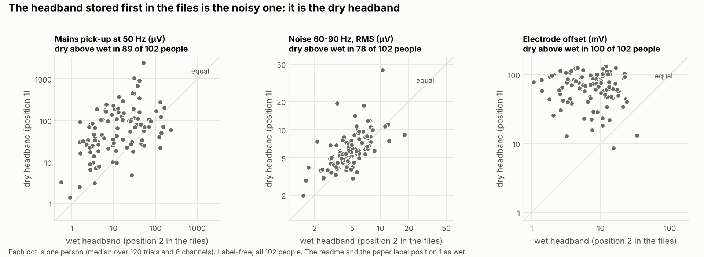

# Wearable SSVEP decoding for new users: calibration cost, dry electrodes, honest evaluation

**Status: M0 (data check) and M1 (standard decoders) done, 13 Nov 2026. The reproduction gate of M1 failed as
pre-registered; the cause was found (see below). M2 has not started.** This README is filled in milestone by
milestone; nothing is reported here before it has been run and reviewed.

A leakage-safe, pre-specified analysis of steady-state visual evoked potential (SSVEP) decoding from an
8-channel wearable EEG headband, on the open dataset of Zhu et al. (*Sensors*, 2021): 102 people, 12 flickering
targets, each person recorded with a **dry-electrode** and a **wet-electrode** headband.

**Question.** How well can the gazed target be decoded for a *new user* with no or few calibration trials,
with dry electrodes, and what does it cost in accuracy, speed (information transfer rate), calibration time
and model size?

> **AI assistance.** The code, analyses, figures and reports in this repository were written and run with an AI
> assistant (Anthropic's Claude) under the author's direction. Direction, research questions, decisions and review are
> the author's; see [Authorship and AI assistance](#authorship-and-ai-assistance).

## What is known so far (M0, data check)

Full report: [`docs/milestones/M0_data_audit.md`](docs/milestones/M0_data_audit.md).

1. **The electrode label of the dataset documentation is reversed.** Position 1 of the electrode axis is the
   dry headband and position 2 the wet one, in the EEG files and in `Impedance.mat` (the readme and the paper
   say "1: wet, 2: dry"). Four independent lines of evidence agree, among them the paper's own impedance values.
2. **Timing and the target table are right:** each of the 12 targets peaks at its own frequency, and the
   response follows the stimulus by 133 to 135 ms.
3. **One 2 s trial carries little signal:** narrow-band SNR of about 3.5 dB at Oz (pure noise: -1.5 dB), below
   1 dB for about a third of the people. It depends on the person far more than on the headband.
4. **Dry and wet differ in noise, hardly in SNR:** over five times more mains pick-up with dry electrodes, but
   only 0.4 dB less SNR at Oz. The headband worn second tends to do worse, so the comparison is a crossover.
5. **The samples are untouched converter values:** 250 Hz was obtained without an anti-aliasing filter, and an
   IIR notch on these short epochs leaves an edge transient (replaced by a least-squares mains removal).

<p align="center"></p>

## What is known so far (M1, standard decoders, 68 development people)

Full report: [`docs/milestones/M1_baselines.md`](docs/milestones/M1_baselines.md).

1. **The pre-registered reproduction gate failed.** With the convention of the public reference code (cut
   the window, then filter; mains kept), none of the ten published accuracies of the dataset paper is
   reproduced within 0.05, and TRCA with the dry headband is at chance (0.14 against a published 0.62).
2. **The decoders are right; the cause is the filtering.** A second, literal implementation gives the same
   decision on 960 of 960 trials. (a) The 50 Hz mains is inside every sub-band and breaks TRCA on this
   unshielded recording. (b) The published values are matched (13 of 14 within 0.05) only when the whole
   2.84 s epoch is filtered before the window is cut, which uses samples recorded after the end of the window.
3. **Without future samples** (project pipeline): FBCCA with no calibration reaches 0.45 (dry) and 0.62 (wet)
   at 1 s, 0.68 and 0.83 at 2 s; ensemble TRCA with per-person calibration 0.52 and 0.84 at 1 s. With the dry
   headband 4 to 7 of 68 people are not above chance at 1 s.
4. **Dry electrodes cost 0.15 to 0.17 in accuracy with FBCCA and 0.26 to 0.33 with ensemble TRCA** for the
   same person. In time: 1.06 s with the dry headband for what the wet one reaches in 0.6 s.
5. **A flaw was found in our own mains-removal step:** it treats each channel separately, which creates a
   small artefact next to 50 Hz and pulls CCA decisions towards the two targets whose 4th harmonic is 49 and
   51 Hz. To be corrected in the M2 plan; the M1 numbers are reported with it.
6. The second dataset (BETA) has not been run yet.

<p align="center"></p>

## How the work is organised

Each milestone has a plan that is committed **before** it is run, and a report committed after it
(see the commit history).

| Milestone | Content | Plan | Report |
|---|---|---|---|
| M0 | Data check: files, layout, electrode type, timing, spectra, signal-to-noise ratio, impedance | [`M0_plan.md`](docs/milestones/M0_plan.md) | [`M0_data_audit.md`](docs/milestones/M0_data_audit.md) |
| M1 | Reproduce the standard methods (CCA, FBCCA, TRCA) and their published results | [`M1_plan.md`](docs/milestones/M1_plan.md) | [`M1_baselines.md`](docs/milestones/M1_baselines.md) |
| M2 | New users and calibration: calibration-free and few-calibration decoding, dry vs wet | | |
| M3 | Small network and test-time adaptation; model size and compute | | |
| M4 | Interpretation and failure cases: time on task, impedance, confusions | | |
| M5 | Real-time replay with measured latency | | |
| M6 | Report and visual summary | | |

The hypotheses and the evaluation rules are in [`docs/analysis_plan.md`](docs/analysis_plan.md).

**Development and lockbox subjects.** Every third subject (S003, S006, ..., S102; 34 people) is a lockbox:
until the final evaluation their recordings are used only for label-free checks. All method development uses
the other 68 people. The rule was fixed before any data file was opened.

## Data

Not included. See [`DATA.md`](DATA.md) for the sources, the licences and the checksums.

## Reproduce

```bash
pip install -r requirements.txt
WEARABLE_DIR=/path/to/13560281 BETA_DIR=/path/to/12264401 ./run_all.sh
```

Python 3.13. On two cores M0 takes about two minutes and M1 about fifteen. `BETA_DIR` is optional for now.

## Repository layout

```
src/ssvep/      wearable.py (dataset constants, loader, development/lockbox split), spectral.py (filters,
                mains removal, Fourier coefficient at an exact frequency, narrow-band SNR, apparent latency),
                filterbank.py (reference filter bank, ways of filtering a short window), decoders.py (CCA,
                FBCCA, TRCA, ensemble TRCA), metrics.py (ITR, chance threshold), plotting.py (one figure style)
scripts/        m0_inventory.py (label-free checks, all subjects), m0_signal_checks.py (timing, spectra,
                SNR, development subjects only), m0_figures.py, m0_summary.py (every number of the audit),
                check_beta_files.py
                m1_edge_transients.py (synthetic), m1_baselines_wearable.py (development subjects only),
                m1_crosscheck.py (second implementation), m1_decision_bias.py (diagnostic),
                m1_summary.py (every number of the report), m1_figures.py
tests/          unit tests on synthetic signals (python -m pytest -q tests)
docs/           analysis_plan.md, milestones/ (one plan and one report per milestone)
results/        result tables (CSV), one folder per milestone
figures/        figures, one folder per milestone
logs/           run logs
```

## Authorship and AI assistance

Project direction, research questions, decisions and review: the author, Salman Almuhammad Alali. The code and
the reports were written and run with an AI assistant (Anthropic's Claude) under the author's direction,
milestone by milestone; every milestone is reviewed and approved before the next one starts.

## Licence

To be added before the repository is made public. The datasets keep their own licences (see `DATA.md`).

## References

- F. Zhu, L. Jiang, G. Dong, X. Gao, Y. Wang, "An Open Dataset for Wearable SSVEP-Based Brain-Computer
  Interfaces", *Sensors* 21(4):1256, 2021. doi: 10.3390/s21041256
- B. Liu, X. Huang, Y. Wang, X. Chen, X. Gao, "BETA: A Large Benchmark Database Toward SSVEP-BCI Application",
  *Frontiers in Neuroscience* 14:627, 2020. doi: 10.3389/fnins.2020.00627
