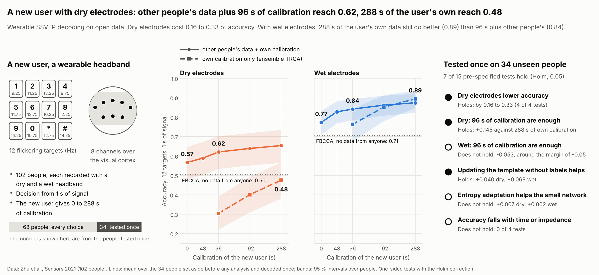
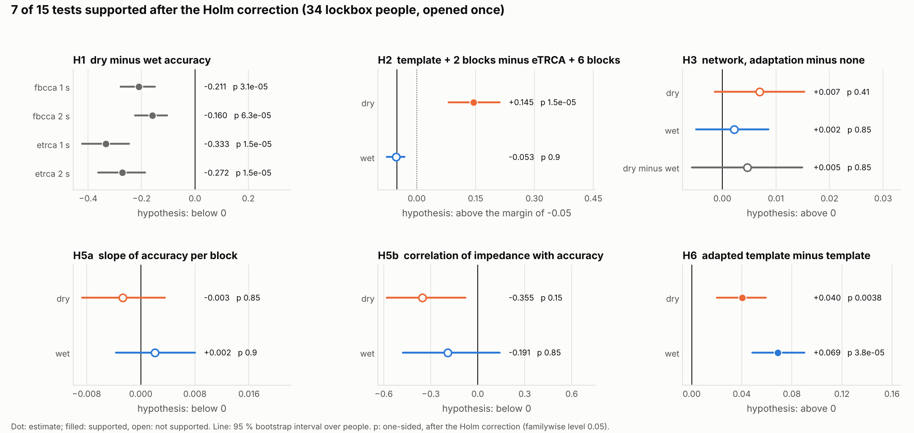
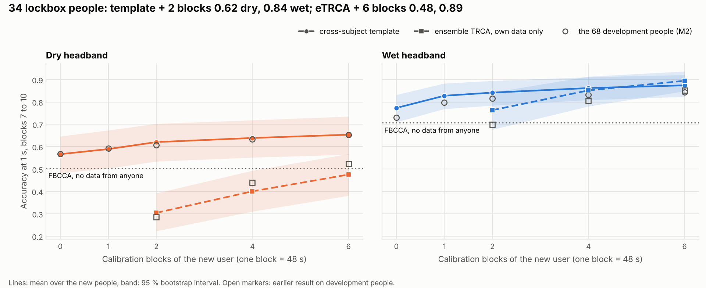
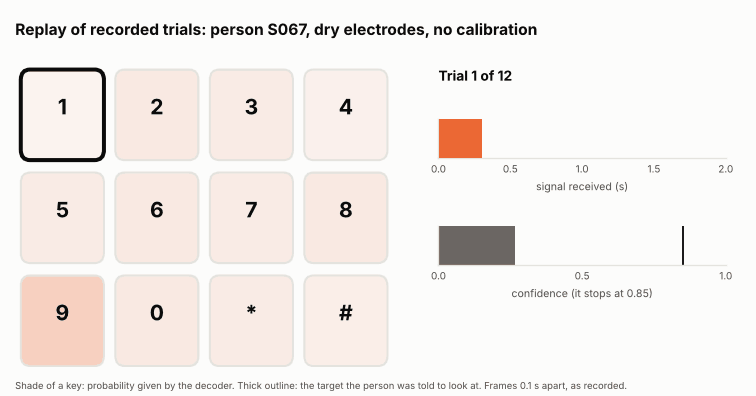
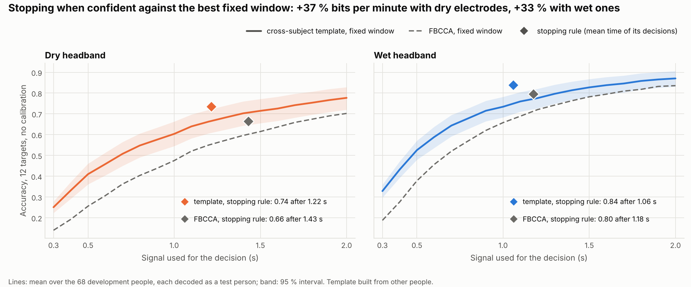
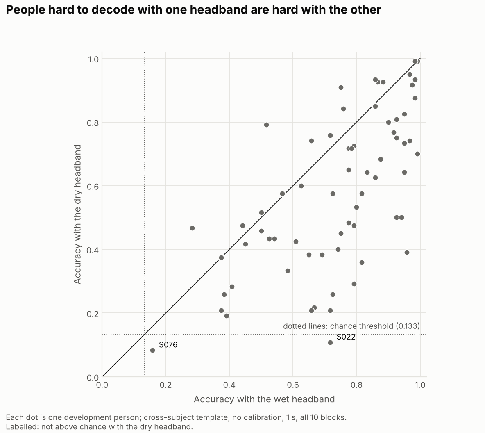
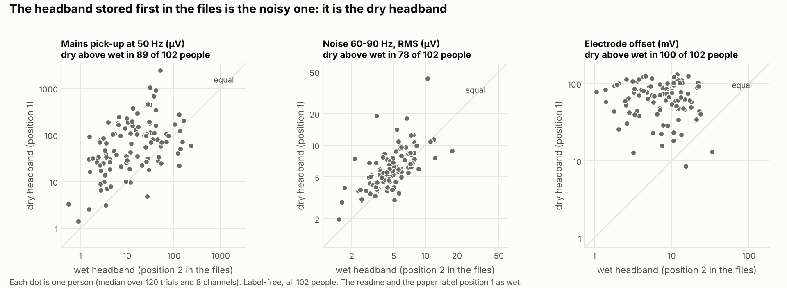
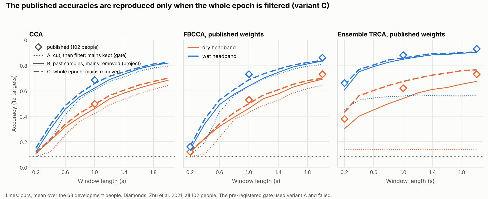
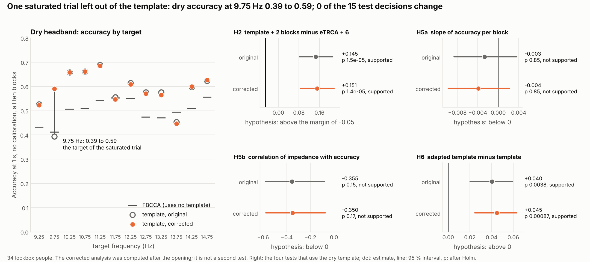

# Wearable SSVEP decoding for a new user: what dry electrodes and a short calibration cost

*Salman Almuhammad Alali, 14 Nov 2026. Repository: <https://github.com/SAamal1076/BCI>. The code and the
reports were written with an AI assistant under the author's direction; see the
[README](README.md#authorship-and-ai-assistance).*



## Summary

A person looks at one of 12 flickering targets; an 8-channel headband over the back of the head records the
EEG; the task is to say which target, from 1 s of signal, for a **new user** who has given no or little
calibration data. On an open dataset of 102 people, each recorded with a dry and a wet headband, every choice
was made on 68 people, and 15 pre-specified tests were then run once on the other 34.

- **Dry electrodes cost accuracy:** 0.16 to 0.33 below wet ones, depending on method and window.
- **With dry electrodes, other people's data replace most of the calibration:** a template built from other
  people plus 96 s of the user's own data reaches 0.62, against 0.48 for the standard per-person method with
  288 s (difference +0.145, 95 % interval +0.081 to +0.211).
- **With wet electrodes they do not:** 288 s of the user's own data stay better (0.89 against 0.84).
- **A template updated with its own decisions, without labels, gains** 0.04 (dry) and 0.07 (wet).
- **Three things did not hold:** entropy adaptation of a small network, a loss of accuracy with time on task,
  and a link between electrode impedance and accuracy.

Seven of the 15 tests are supported after correction for multiple testing, and they are the seven that were
expected in writing before the test people were decoded.

Two things were added after the tests, on the development people only and without tests:

- **On a stream** (replayed recordings), the decoder gives the same decisions, updates in 15 ms, and gains
  about a third in bits per minute when it stops as soon as it is confident instead of waiting a fixed time.
- **A flaw was found and corrected:** one saturated trial of one person spoiled one entry of the dry template
  that all the earlier steps used. Leaving it out raises the dry accuracy of the template by about 0.01 and
  **changes none of the 15 test decisions**. The numbers of this report are those of the method as it was
  frozen; the corrected ones are given next to them (sections 4 and 8).

## 1. Data

The dataset is that of Zhu et al. (2021): 102 healthy people, 8 channels (POz, PO3, PO4, PO5, PO6, Oz, O1,
O2), 250 Hz, 12 targets between 9.25 and 14.75 Hz, 2 s of stimulation per trial. Each person did 10 blocks of
12 trials with a dry-electrode headband and 10 blocks with a wet-electrode one; 53 wore the dry one first. One
block is 48 s of recording. A second dataset, BETA (Liu et al. 2020; 70 people, laboratory amplifier), was
used only to check the implementations.

Raw data are not in the repository; [`DATA.md`](DATA.md) gives the sources, licences and checksums.

## 2. How the evaluation was kept honest

1. **Lockbox.** Before any file was opened, every third person (34 people) was set aside. Their trials were
   decoded once, at the end, for the tests. They were decoded once more for the correction of section 8,
   which is labelled as computed afterwards and is not a test.
2. **Plan, code, result, in that order.** Each milestone has a plan committed before its code was run, and a
   report committed after. The order can be read in the commit history.
3. **No test on the people used for choices.** On the 68 development people only estimates with intervals
   were reported, no p-value.
4. **One family of tests.** Six hypotheses, 15 one-sided tests, Holm correction at a familywise level of 0.05,
   all fixed before the opening. The expected outcome was written down as well.
5. **The opening was rehearsed.** The same script was first run with development people in the role of the
   new people. It reproduced the earlier results exactly where it should (552 accuracies), and the script,
   the networks and the template for the test people were committed before the opening.
6. **No information from the future.** A decision uses no sample recorded after the end of its window.

Details: [`docs/analysis_plan.md`](docs/analysis_plan.md) and the plans in [`docs/milestones`](docs/milestones).

## 3. Methods

**Preprocessing (frozen in M2).** The mains component near 50 Hz is removed by least squares, with one
frequency per trial for all channels. Three sub-bands (6, 14 and 22 Hz to 45 Hz) and three harmonics are used,
with weights fixed in advance, `w(n) = n^(-1.25) + 0.25`.

**Decoders.**

| Decoder | What it needs from the user | What it needs from others |
|---|---|---|
| FBCCA: correlation with sines at the target frequencies | nothing | nothing |
| Ensemble TRCA: spatial filters and templates from the user's own trials | calibration trials | nothing |
| Cross-subject template: the mean response of other people, combined with the user's own mean response as `T = (n0 P + k I) / (n0 + k)` with `n0 = 4` and `k` calibration blocks | 0 to 6 blocks | 68 people |
| The same template, updated with its own decisions on unlabelled trials | 72 trials without labels | 68 people |
| Small network (EEGNet type, 3 572 parameters), with or without adaptation of its normalisation statistics and entropy minimisation | 72 trials without labels | 68 people |

**New-user design.** The first `k` blocks of a person are calibration (`k` = 0, 1, 2, 4, 6), blocks 7 to 10 are
the test (48 trials), and the person's data are never part of what the method was built on.

## 4. Tested results

All numbers in this section are from the 34 lockbox people. The lockbox was opened once, in a single run,
from a commit pushed beforehand ([`final_evaluation.md`](docs/milestones/final_evaluation.md)).



| Hypothesis | Outcome | Estimate [95 % interval] |
|---|---|---|
| H1 Dry electrodes give lower accuracy | **supported, 4 of 4** | -0.21 (FBCCA, 1 s), -0.16 (FBCCA, 2 s), -0.33 (ensemble TRCA, 1 s), -0.27 (ensemble TRCA, 2 s) |
| H2 Template + 2 blocks is within 0.05 of ensemble TRCA + 6 blocks | **dry: supported** | +0.145 [+0.081, +0.211] |
| | wet: not supported | -0.053 [-0.076, -0.031] |
| H3 Entropy adaptation helps the network, more with dry electrodes | not supported, 0 of 3 | +0.007 dry, +0.002 wet |
| H5 Accuracy falls over the session; higher impedance, lower accuracy | not supported, 0 of 4 | slope per block -0.003 dry, +0.002 wet; correlation -0.35 dry, -0.19 wet |
| H6 The template adapted without labels is better | **supported, 2 of 2** | +0.040 [+0.020, +0.059] dry, +0.069 [+0.048, +0.090] wet |

**Corrected analysis** (computed after the opening, so it is not a second test; section 8, point 5). Four of
the 15 tests use the dry template. With the saturated trial left out of it, the other 11 tests are identical
and these four keep their outcome:

| Test | Original (pre-specified) | Corrected (after the opening) |
|---|---|---|
| H2 dry | +0.145 [+0.081, +0.211], supported | +0.151 [+0.088, +0.216], supported |
| H5 dry, slope per block | -0.003 [-0.009, +0.004], not supported | -0.004 [-0.010, +0.002], not supported |
| H5 dry, correlation with impedance | -0.35 [-0.58, -0.08], not supported | -0.35 [-0.58, -0.07], not supported |
| H6 dry | +0.040 [+0.020, +0.059], supported | +0.045 [+0.025, +0.063], supported |

Three remarks belong with the table of the hypotheses.

- **H6 was formulated after its effect had been seen** on the development people. The lockbox confirms it, but
  it is not a prediction made in advance like the others.
- **H5b with dry electrodes** has a correlation of -0.35 and a p-value of 0.019 before the correction (0.15
  after). On the development people the same correlation was +0.07. The two sets disagree, and the
  hypothesis is not supported.
- **The development numbers were not optimistic.** With no calibration the template reaches 0.567 (dry) and
  0.773 (wet) on the lockbox people, against 0.568 and 0.730 on the development people. What did shrink is its
  advantage over FBCCA with dry electrodes: +0.062 [+0.034, +0.089], against +0.104 on the people the
  preprocessing was chosen on.

## 5. The cost of a new user

**Calibration time.** Accuracy at 1 s on blocks 7 to 10, lockbox people:



| Method | Calibration | Dry | Wet |
|---|---|---|---|
| FBCCA | none | 0.504 | 0.707 |
| Cross-subject template | none | 0.567 | 0.773 |
| Template adapted without labels | none (288 s of unlabelled signal) | 0.607 | 0.842 |
| Small network | none | 0.508 | 0.682 |
| Cross-subject template | 96 s | 0.621 | 0.842 |
| Cross-subject template | 288 s | 0.654 | 0.874 |
| Ensemble TRCA | 96 s | 0.305 | 0.763 |
| Ensemble TRCA | 288 s | 0.475 | 0.895 |

- Other people's data matter most when the user has given nothing. With two blocks of the user's own they
  still add 0.03 with dry electrodes and nothing with wet ones; with six blocks they add nothing for either.
- Ensemble TRCA needs many blocks, and with dry electrodes it stays behind at every amount tried.
- The small network stays below the template (by 0.058 dry and 0.092 wet) and gains almost nothing from
  adaptation. Four of its six trainings stopped at the limit of 60 epochs, so it may be under-trained.

**Size and compute** (M3, one processor core, one 1 s trial): the preprocessing takes 6.1 ms, FBCCA 0.25 ms,
the template decoder 5.4 ms and the network 0.9 ms. The network stores 3 652 numbers, the template 72 000.
All are far below the 1 s of signal a decision needs.

## 6. On a stream: latency and stopping when confident

*M5, added after the tests. Development people only, each decoded by a template and by settings that never saw
them; descriptive, no test ([`M5_realtime.md`](docs/milestones/M5_realtime.md)).*



A device receives samples as they arrive. The recordings were therefore replayed in pieces of 0.1 s, and the
decoder updated its decision 18 times between 0.3 s and 2.0 s, with the samples received so far.

- **Same decisions.** All 29 376 updates of 1 632 replayed trials have exactly the scores of the fixed-window
  code.
- **Latency.** One update takes 15 ms (median; 95th percentile 23 ms) on one processor core in Python, for the
  100 ms between two updates.
- **Stopping when confident.** The scores are turned into probabilities, and the decoder decides as soon as
  the largest one reaches a threshold chosen on other people. Against the best fixed window, chosen the same
  way, and with 0.5 s to move the eyes:

| Cross-subject template, no calibration | Dry | Wet |
|---|---|---|
| Best fixed window (bits/min) | 58.1 | 79.0 |
| Stopping when confident (bits/min) | 79.4 | 104.9 |
| Difference [95 % interval] | +21.3 [+17.7, +24.7] | +25.8 [+22.3, +29.4] |
| People who are faster with it | 65 of 68 | 68 of 68 |
| Accuracy and mean time of a decision | 0.74 after 1.22 s | 0.84 after 1.06 s |



- **The confidence is not reliable for everybody.** It is 0.07 too high on average with dry electrodes, and
  0.21 too high for the third of the people who are hardest to decode. With dry electrodes 22 % of the
  decisions (wet: 16 %) are forced at 2.0 s without confidence, and those are right only 41 % (dry) and 54 %
  (wet) of the time.

## 7. When it fails

- **Nobody among the 34 lockbox people is below chance with the template;** one is with FBCCA and dry
  electrodes. Among the 68 development people two were below chance with the template and dry electrodes, and
  one of them decoded well with wet ones, which points to the dry contact.
- **Who is hard to decode is mostly a property of the person** (M4, development people): accuracy with the dry
  headband goes with accuracy with the wet one (Spearman 0.68) and with the single-trial signal-to-noise
  ratio (0.64 dry, 0.55 wet).



- **The headband worn second is 0.03 lower** in both sets of people, so dry and wet must be compared as a
  crossover, as was done.
- **The template makes no systematic confusion.** FBCCA confuses targets 0.5 Hz apart 1.3 to 1.4 times more
  often than an even spread of errors would (development people).

## 8. What went wrong on the way

Five findings changed the work. Each was reported when it was found.

1. **The dataset's electrode label is reversed** (M0). The documentation says "1: wet, 2: dry"; the files hold
   the dry headband first. Four independent checks agree, among them the paper's own impedance values, and
   the decoding results confirmed it. Following the documentation would have swapped dry and wet everywhere.

   

2. **The reproduction gate failed** (M1). With the usual convention (cut the window, then filter) none of ten
   published accuracies was reproduced within 0.05; ensemble TRCA with dry electrodes was near chance (0.14
   against a published 0.62). The cause was found: mains interference inside the pass-band, and the fact that
   the published values are matched only when the whole 2.84 s epoch is filtered before the window is cut,
   which uses samples recorded after the window. With that, 13 of 14 published values are within 0.05. On
   BETA, recorded with a laboratory amplifier, the same code reproduces the published peak rates within 4 %.
   The gate stays recorded as failed, and the project went on without future samples.

   

3. **The first mains removal biased the decisions** (M1, corrected in M2). Choosing the mains frequency for
   each channel separately left a narrow-band artefact: 29 % of the FBCCA decisions went to the two targets
   whose fourth harmonic lies next to 50 Hz. With one frequency per trial for all channels it is 18 %, where
   17 % is the value without bias.
4. **A plan was wrong about the keypad** (M4). It assumed a layout in which neighbouring targets are 0.5 Hz
   apart. The paper shows the opposite design, so the classes of errors were redefined, in code and in a unit
   test, before any decision was looked at.
5. **One saturated trial spoiled one entry of the dry template** (found in M5, after the tests). The template
   is a plain mean over people. One trial of one development person reaches the limit of the converter; M0 had
   flagged it, and it was not left out. It makes the template of the 9.75 Hz target with dry electrodes about
   4 times too large and mostly artefact, in M2, M3, M4 and in the final evaluation. On the development people,
   leaving that one trial out raises the dry accuracy from 0.578 to 0.590, and at 9.75 Hz from 0.35 to 0.53; wet
   is not affected. The tests that use the dry template (H2, H5 and H6 with dry electrodes) were therefore run
   with a slightly handicapped template.

   The plan of the final evaluation says that an error found afterwards is reported with the original and the
   corrected result. So, by a plan approved before any code was written, the same analysis was run **once**
   more on the lockbox people with that one trial left out of the template
   ([`final_correction.md`](docs/milestones/final_correction.md)). Everything that does not use the dry
   template came out identical to the opening. The four tests that use it keep their outcome (section 4), so
   **the same seven tests are supported in both analyses**. With dry electrodes the template with no
   calibration goes from 0.567 to 0.577, and at 9.75 Hz from 0.39 to 0.59. The corrected numbers were computed
   after the lockbox results had been seen: they are reported next to the original ones and are not a second
   test.

   

## 9. Recommendations for a product team

Each line says what it rests on: **tested** (34 lockbox people, once) or **descriptive** (development people).

| Recommendation | Evidence |
|---|---|
| With dry electrodes, start a new user from other people's data and ask for about 1.5 minutes of calibration. More of the user's own data is not needed to beat a per-person method with 5 minutes. | Tested (H2 dry: 0.62 against 0.48) |
| With wet electrodes and 5 minutes to spare, calibrate on the user alone. | Tested (H2 wet not supported: 0.89 against 0.84) |
| Keep adapting the template from use, without labels. | Tested (H6: +0.04 dry, +0.07 wet; formulated after seeing the development people) |
| Do not wait a fixed time: decide when confident. | Descriptive (M5: about +35 % bits/min) |
| When the confidence is not reached, do not force a decision; ask for another look. | Descriptive (M5: forced decisions are right 41 % to 54 % of the time) |
| Do not use one confidence scale for everybody; adapt it to the person. | Descriptive (M5: 0.21 too high for the hardest third) |
| Do not count on a small network with entropy adaptation instead of the template at this amount of data. | Tested for the adaptation (H3 not supported); descriptive for the comparison (the network is 0.06 to 0.09 below the template); one network, one training recipe |
| Treat the dry contact as the bottleneck, and judge it from the signal: impedance did not predict decoding. | Tested (H1: -0.16 to -0.33; H5b not supported) |
| Protect a template shared between users against one bad recording. | Descriptive (one saturated trial of one person: 0.59 to 0.39 on one target for the lockbox people, 0.53 to 0.35 for the development people) |
| Computing is not the constraint. | Descriptive (15 ms per update in Python on one core) |

## 10. Limits

- One dataset from one laboratory, healthy people, cue-guided trials, 12 targets, analysed offline.
- 34 people in the tests. Intervals are over people; a result for one person is far less certain.
- H6 was formulated after seeing the development people.
- One small network and one training recipe; the conclusion about the network holds for these.
- Published accuracies on this dataset are not comparable with the ones here: they use samples after the
  window, and parameters tuned on the same recordings.
- The stream of section 6 is a replay of recordings on development people: nobody reacts to the decisions,
  the decoder is told when the flicker starts, and the times are those of Python code on one machine. It is
  not a claim about a person using a device.
- The dry template used in the tests had one spoiled entry (section 8, point 5). The corrected analysis
  changes no decision, but it was made after the results had been seen.
- The Wilcoxon p-values depend a little on how tied differences are represented in floating point (for
  example 0.00034 instead of 0.00043 for H6 dry). No decision is near its threshold, and none changes
  ([`final_evaluation.md`](docs/milestones/final_evaluation.md), section E).
- **Not done:** the exploratory hypothesis H4 (graph-based denoising).

## 11. What I would do next

1. **Record a person using it.** The replay shows that the decoder keeps up with a stream; only a live
   recording shows what happens when the user sees the decisions.
2. **Use the unlabelled stream.** The template update of H6 was done once on 72 trials; an update after every
   decision is the natural next version, and the same trials can set the confidence scale of the person.
3. **Look at the dry contact,** which is where the accuracy is lost: per-channel quality from the signal
   itself, since impedance did not predict decoding.
4. **A second wearable dataset,** to see which of these results survive another headset and another laboratory,
   and to test a template that is protected against bad recordings, which cannot be tested here any more.

## 12. Reproduce

```bash
pip install -r requirements.txt
python -m pytest -q tests
WEARABLE_DIR=/path/to/13560281 BETA_DIR=/path/to/12264401 ./run_all.sh
```

Python 3.13; under three hours on two processor cores, most of it for 36 small networks. The
lockbox steps of `run_all.sh` open nothing again: they recompute the numbers of the opening and of the
corrected analysis into separate folders and compare them with the committed ones. At the time of the opening
its numbers were identical byte for byte.

## References

- F. Zhu, L. Jiang, G. Dong, X. Gao, Y. Wang, "An Open Dataset for Wearable SSVEP-Based Brain-Computer
  Interfaces", *Sensors* 21(4):1256, 2021. doi: 10.3390/s21041256
- B. Liu, X. Huang, Y. Wang, X. Chen, X. Gao, "BETA: A Large Benchmark Database Toward SSVEP-BCI Application",
  *Frontiers in Neuroscience* 14:627, 2020. doi: 10.3389/fnins.2020.00627

The methods (CCA, filter-bank CCA, task-related component analysis, EEGNet, entropy minimisation at test
time) are standard; the milestone reports say how each was implemented and checked.
