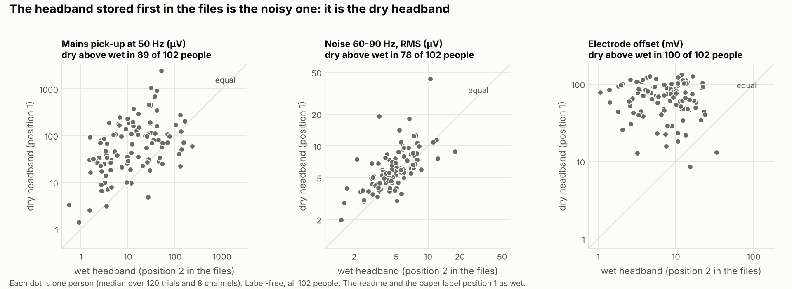
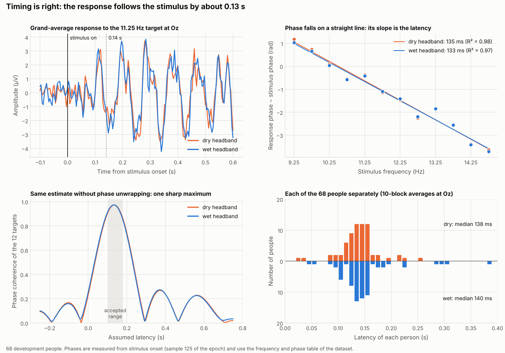
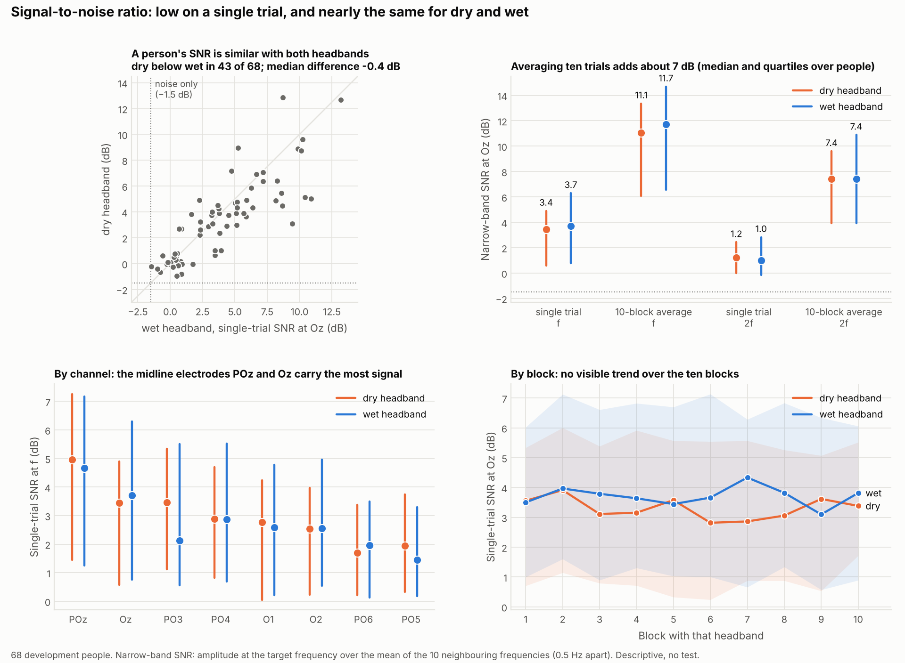

# M0 data audit: wearable SSVEP dataset (before any decoding)

*12 Nov 2026. Plan: [`M0_plan.md`](M0_plan.md), committed before any data file was opened. Label-free checks
use all 102 people; every check that uses the target of a trial uses the 68 development people only (the 34
lockbox people were not loaded). Descriptive statistics only, no hypothesis test. Every number below is
recomputed by `scripts/m0_summary.py` (`logs/m0_summary.log`).*

## Result in short

1. **The files are intact and the layout is as documented, with one exception that matters: the electrode
   label of the readme and the paper is reversed.** Position 1 of the electrode axis is the **dry** headband
   and position 2 the **wet** one, in the EEG files and in `Impedance.mat`. The documentation says
   "1: wet, 2: dry". Following the documentation would swap dry and wet in every result.
2. **Timing and the target table are right.** Every one of the 12 targets gives its largest peak at its own
   frequency, and the response follows the stimulus by 133 to 135 ms (expected: about 140 ms).
3. **A single 2 s trial carries little signal.** At Oz the narrow-band SNR of one trial is about 3.5 dB
   (pure noise gives -1.5 dB), and with each headband 21 of the 68 people are below 1 dB. It is a property
   of the person much more than of the headband.
4. **Dry and wet differ in noise, not much in SNR.** The dry headband picks up over five times more mains
   interference and has eight times the electrode offset, but its narrow-band SNR at Oz is only 0.4 dB lower.
5. **The plan needed one correction (D1):** an IIR notch on these short epochs leaves an edge transient
   inside the response window. It was replaced before any timing or SNR result was computed.

## Acceptance criteria

| | Criterion | Result |
|---|---|---|
| C1 | 102 files load, shape (8, 710, 2, 10, 12), all values finite | **Pass.** |
| C2 | Mean impedance within 5 % of the paper; wearing order 53 / 49 | **Pass**, exact: 261.67 and 19.63 kOhm; 53 dry-first, 49 wet-first. The two values sit at the positions opposite to the documented ones (section 3). |
| C3 | Electrode position settled | **Pass, against the documentation:** position 1 = dry, position 2 = wet. Final confirmation in M1 (published accuracies: wet above dry). |
| C4 | Group spectrum peaks at the target's own frequency (24 checks) | **Pass**, 24 of 24. |
| C5 | Group apparent latency between 0.10 and 0.18 s | **Pass:** dry 135.0 ms, wet 132.6 ms (R2 = 0.975 for both). |

## 1. Files

- 106 files, 973.9 MB. The MD5 of every file equals the checksum published by figshare: the copy is
  bit-identical to the publisher's. Licence on figshare: CC BY 4.0.
- BETA (reference dataset, used from M1): 72 files, 5.28 GB, all MD5 equal to figshare's. Not opened yet.
- `data_manifest.csv` lists size and checksums of both.

## 2. Layout, units and what "raw" means here

- Every subject file holds `data`, double precision, (8, 710, 2, 10, 12). No non-finite value, no flat
  channel, no duplicated trial among the 24 480 trials.
- `Impedance.mat` is (8, 10, 2, 102) = channel x block x type x subject, as the readme says (the paper prints
  another order). `Subjects_Information.mat` is a 103 x 11 cell table (header row; the 11th column is the
  headband worn first).
- Values are in microvolts and lie on a grid of 0.0447035 µV, which is 750 mV / 2^24: a 24-bit converter
  over +/-375 mV. Every sample-to-sample difference is a multiple of that step.
- **Consequence:** the samples are untouched converter values, so the reduction from 1000 Hz to 250 Hz kept
  every fourth sample **without an anti-aliasing filter** (the readme says "without any other processing").
  Noise between 125 and 500 Hz is folded into the band and cannot be removed afterwards. A line at 100 Hz is
  visible (dry 14.7 µV, wet 2.4 µV); it may be the third mains harmonic (150 Hz) folded to 100 Hz.
- Electrode offsets are large, as expected for raw data: median 70 mV (dry) and 8.6 mV (wet). One trial
  reaches the limit of the converter (S067, dry, block 4, target 4).
- Trials were shown in random order inside a block but are stored sorted by target: **the order of trials
  inside a block is lost.**

## 3. Which position is the dry headband

The documentation labels the type axis "1: wet, 2: dry" for `Impedance.mat` and gives no label for the EEG
array. The data say the opposite, on every line of evidence:

| Evidence | Finding |
|---|---|
| E1, impedance values | Position 1: mean 261.67 kOhm (SEM 28.74). Position 2: 19.63 kOhm (SEM 1.20). These are exactly the paper's values for **dry** (261.67 +/- 28.74) and **wet** (19.63 +/- 1.20). So in `Impedance.mat` position 1 is dry. |
| E2, noise in the EEG (label-free, expectation fixed in the plan: dry is noisier) | EEG position 1 has more mains pick-up than position 2 in 89 of 102 people (median 67 vs 12 µV), more 60-90 Hz noise in 78 of 102, and a larger electrode offset in 100 of 102. |
| E3, link between the two files without any label | Across people, the impedance at position 1 goes with the mains pick-up of EEG position 1 (Spearman 0.74) and not with that of EEG position 2 (0.12). Same for 60-90 Hz noise (0.48 vs 0.14). The two files use the same order. |
| E4, independent loader | SSVEP-Analysis-Toolbox reads `data[:, :, 0]` as dry and `data[:, :, 1]` as wet (zero-based), i.e. position 1 = dry. |

Decision: **position 1 = dry, position 2 = wet** (`wearable.DRY = 0`, `wearable.WET = 1`). The plan's rule
expected the documented label to be one of the agreeing lines; instead the label is the only thing that
disagrees, and it is contradicted by the paper's own numbers. Figure: `figures/m0/01_noise_dry_vs_wet.png`.

## 4. Noise and artefacts (label-free, 102 people)

Median over people of each person's median (quartiles in brackets):

| | Dry | Wet |
|---|---|---|
| Mains pick-up at 50 Hz (µV) | 67.0 [26.1, 126.9] | 12.0 [3.8, 32.1] |
| Noise 60-90 Hz, RMS (µV) | 5.9 [4.5, 7.6] | 4.8 [3.6, 6.2] |
| Drift below 3 Hz, RMS (µV) | 54.6 [31.1, 83.0] | 28.2 [16.7, 47.7] |
| RMS after preprocessing, 3-90 Hz (µV) | 14.5 [11.5, 18.1] | 12.6 [10.2, 16.7] |
| Electrode offset (mV) | 70.4 [46.4, 92.7] | 8.6 [4.1, 12.7] |
| Trials above 200 µV peak-to-peak on at least one channel | 35.0 % | 12.9 % |
| People with more than half of their trials above 200 µV | 28 | 6 |

- Mains interference is the dominant noise: up to 2470 µV for one person (S035, dry), against a response of
  about 2.5 µV. Apart from the mains lines the two spectra are close (0.92 vs 0.87 µV at 75 Hz).
- A 200 µV rejection threshold would discard a third of the dry trials. **Nothing is excluded** (plan); the
  decoders have to cope with these trials.
- Figure: `figures/m0/02_noise_spectrum.png`.

## 5. Impedance and people

- Dry: mean 261.7 kOhm but median 146.5 kOhm; the mean is pulled up by a few very high values (3 % of the
  readings are above 1 MOhm, maximum 19.9 MOhm). Wet: mean 19.6, median 15.5 kOhm.
- Over the ten blocks the **dry impedance rises** (median 115 to 176 kOhm) and the **wet impedance falls**
  (20.5 to 13.2 kOhm). The wet electrodes do not get worse during the session.
- Impedance goes with mains pick-up for the dry headband (Spearman 0.74, 102 people) but **not with SNR**
  (0.11 dry, 0.08 wet, 68 development people).
- 64 men and 38 women, age 30.0 +/- 8.3 years (8 to 52; seven people are under 18). Headband worn first: dry
  53, wet 49.
- The development and lockbox groups are balanced: dry-first 35 of 68 and 18 of 34; women 26 of 68 and
  12 of 34; mean age 29.9 and 30.3.
- Figure: `figures/m0/03_impedance.png`.

## 6. Timing (68 development people)

- Group latency from the slope of phase against frequency (grand-average Oz waveform): **dry 135.0 ms, wet
  132.6 ms**, R2 = 0.975 for both. The phase-coherence scan gives 135 and 133 ms. The eight channels agree
  (131 to 142 ms).
- Control: with the phase table ignored, the estimate jumps to -365 ms, i.e. 0.5 s away, as it must. So the
  onset at sample 125, the frequency table and the phase table are all right.
- Per person (own 10-block averages): median 138 ms (dry) and 140 ms (wet), quartiles 123-150 and 124-152 ms.
  57 (dry) and 54 (wet) of 68 people fall between 100 and 180 ms; the others are people with a weak response
  (phase coherence below 0.7 in 10 and 5 people).
- The 0.14 s used to cut the epochs is consistent with the data.

## 7. Spectra and signal-to-noise ratio (68 development people)

- **Target table.** In the grand average at Oz the peak at the target's frequency is 1.28 to 2.43 µV (dry)
  and 1.38 to 2.39 µV (wet); the largest peak at any other grid frequency is 0.51 µV. On single trials the
  mean amplitude is 2.88 µV (dry) and 2.93 µV (wet) at the attended frequency against 1.69 and 1.56 µV at the
  frequencies of the other 11 targets, which is the noise floor: the unattended targets leave no visible
  response at Oz (their SNR is -1.8 dB; pure noise gives -1.5 dB, and slightly less here because the attended
  frequency is sometimes among the neighbours). Figures `04_group_spectra.png`, `05_attended_matrix.png`.
- **Single-trial SNR at Oz:** median 3.44 dB dry [0.58, 4.90] and 3.70 dB wet [0.76, 6.30]. At twice the
  frequency: 1.21 and 0.98 dB.
- **Averaging ten trials** raises it to 11.05 dB (dry) and 11.73 dB (wet): 7.6 and 8.0 dB of the 10 dB that
  perfectly repeatable responses would give. This is the gain a per-person template can use.
- **People differ far more than headbands.** Range -0.9 to 12.9 dB (dry) and -1.4 to 13.2 dB (wet). Below
  1 dB: 21 people with either headband; below 0 dB: 11 (dry) and 7 (wet). A person's SNR with one headband
  predicts the other (Spearman 0.87).
- **Dry versus wet, same person:** dry is lower in 43 of 68 people, median difference -0.37 dB (10-block
  average: -0.92 dB). Small, while the published accuracies differ by 13 points (FBCCA at 2 s). The narrow-band
  SNR at Oz therefore does not explain the published gap by itself (to be examined in M4).
- **Order of wearing matters.** For the people who wore the dry headband first the within-person difference
  is -0.03 dB (dry lower in 19 of 35); for those who wore the wet one first it is -0.97 dB (24 of 33). The
  headband worn second tends to do worse, so headband and time in the session are mixed.
- **Channels.** POz is the best single channel (5.0 dB dry, 4.7 dB wet), then Oz; PO5 and PO6 are the
  weakest (1.4 to 2.0 dB).
- **Frequencies.** SNR is lowest at 9.25 and 9.75 Hz (1.4 to 2.8 dB), where the background EEG is strongest.
- **Blocks.** No visible trend over the ten blocks of a headband (dry 2.8 to 3.9 dB, wet 3.1 to 4.3 dB).

## 8. Comparison with the dataset paper (its Figure 4: 11.25 Hz target, Oz)

The paper used all 102 people; M0 uses 68. Amplitudes in µV:

| Harmonic | Paper, dry | Ours, dry | Paper, wet | Ours, wet |
|---|---|---|---|---|
| f = 11.25 Hz | 2.44 | 2.53 | 2.60 | 2.61 |
| 2f = 22.5 Hz | 1.12 | 1.20 | 1.26 | 1.30 |
| 3f = 33.75 Hz | 0.71 | 0.75 | 0.75 | 0.80 |
| 4f = 45 Hz | 0.30 | 0.54 | 0.32 | 0.49 |

- "Ours" is the mean over people of the amplitude of each person's 10-block average. With this reading the
  first three harmonics agree within 8 %, and wet is above dry as in the paper. The fourth harmonic is at the
  noise floor and does not agree.
- The amplitude of the grand average over people is lower (2.08 and 2.24 µV at f) because people differ in
  latency. The paper does not say which average it used.
- The paper's SNR values (7.51 dB dry, 8.17 dB wet at f) lie between our single-trial values (3.9 and 4.2 dB
  for this target) and our 10-block-average values (10.3 and 10.5 dB). Its procedure is not specified enough
  to be reproduced, and its equation 3 prints a sum where the text says mean.

## 9. What M0 changes for the next milestones

1. **Use `wearable.DRY` and `wearable.WET`, never the documented label.** M1 must confirm it with accuracies.
2. **Analyse dry versus wet as a crossover.** The order of wearing must be a factor in H1, and H5 (time on
   task) cannot be separated from the change of headband without it.
3. **H5 has block resolution only**, and the real-time replay of M5 needs a simulated trial order.
4. **Filters and short epochs.** Only 0.2 s follows the response window, and mains interference is 5 to 1000
   times larger than the response. Every filter of the decoding pipeline must be checked for edge transients
   on synthetic data, as was done here.
5. **Expect a group of poorly decodable people** (about a third below 1 dB) for methods without calibration.
   Per-person results and the failure analysis (M4) matter more than the mean.
6. **Aliased noise** is part of the data. Published numbers on this dataset share this limit.
7. **Published accuracies are optimistic** (parameters tuned on the same recordings; noted in the analysis plan).
8. Wording of H1 and the crossover analysis are to be fixed in `docs/analysis_plan.md` before M1 and M2.

## 10. Deviations from the M0 plan

| | Deviation | Why |
|---|---|---|
| D1 | The 50 Hz IIR notch was replaced by a least-squares removal of the mains component (`spectral.remove_mains`), applied before the band-pass. | On a 2.84 s epoch the notch leaves an edge transient inside the response window when mains pick-up is strong (unit test). On the recordings it raised the noise floor at stimulus-free frequencies by more than 5 % in 14 of 204 recordings, all dry, and doubled it in two (S035, S094). It would have biased the dry-wet comparison. Found on label-free quantities, before any SNR was computed. |
| D2 | Label-free descriptors added: electrode offset, samples at the converter limit, value grid, mean noise spectrum. | The first run showed values up to +/-375 mV. |
| D3 | C3 was settled against the documented label. | The label is contradicted by the paper's own impedance values and by E2, E3 and E4. |
| D4 | The comparison with the paper's Figure 4 reports two ways of averaging. | The paper does not specify its own. |
| D5 | BETA checksums were computed on the author's computer and compared with figshare's; the files were not copied to the analysis workspace. | 5.3 GB. |
| D6 | Two descriptive tables were added: dry-wet difference by order of wearing, and impedance against noise and SNR. | Needed to read section 7 correctly. |

Nothing else differs from the plan. No classifier was run, nothing was excluded, no lockbox label was used.

## 11. Files

- `results/m0/`: `acceptance.csv`, `inventory.csv`, `noise_per_subject*.csv`, `noise_spectrum.csv`,
  `flagged_trials.csv`, `duplicate_trials.csv`, `impedance_*.csv`, `subjects_summary.csv`,
  `dry_wet_evidence.csv`, `snr_per_subject*.csv`, `snr_by_wearing_order.csv`, `attended_matrix.csv`,
  `group_spectrum.csv`, `c4_group_peaks.csv`, `latency_*.csv`, `paper_fig4_check.csv`.
- `figures/m0/01` to `07`. `logs/m0_*.log`. `data_manifest.csv`.
- Reproduce: `WEARABLE_DIR=... BETA_DIR=... ./run_all.sh` (about two minutes).
