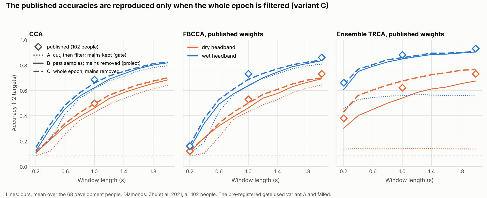
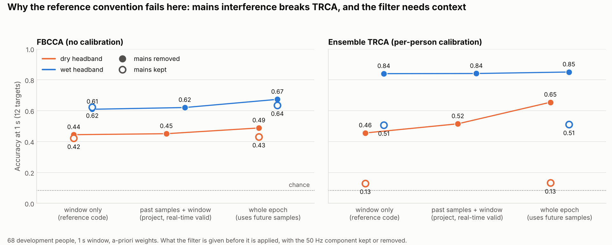
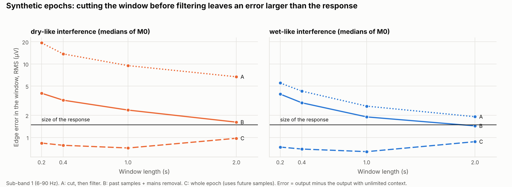
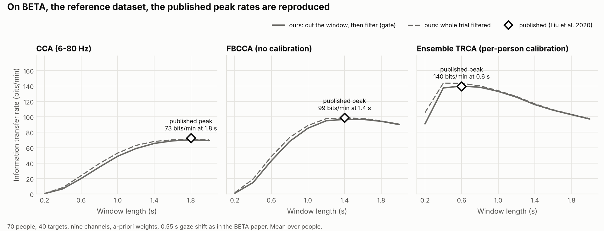
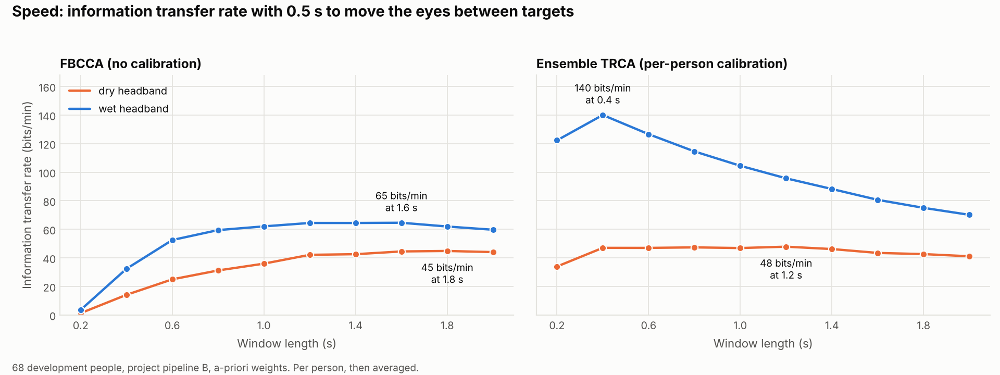
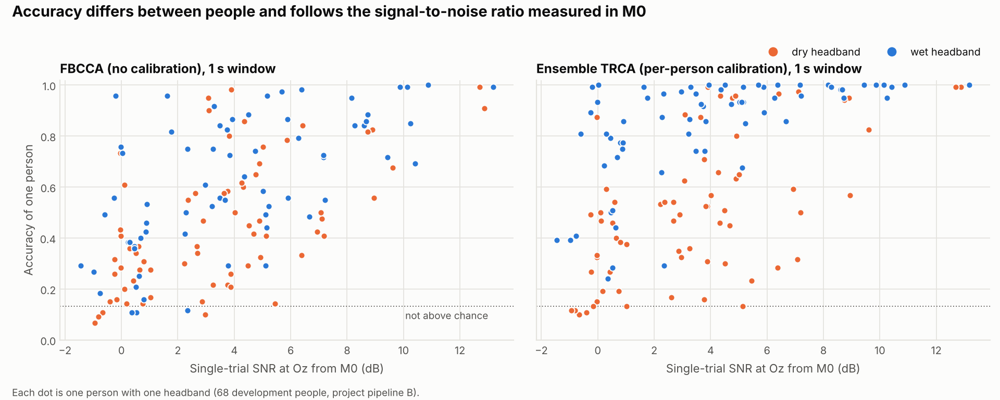
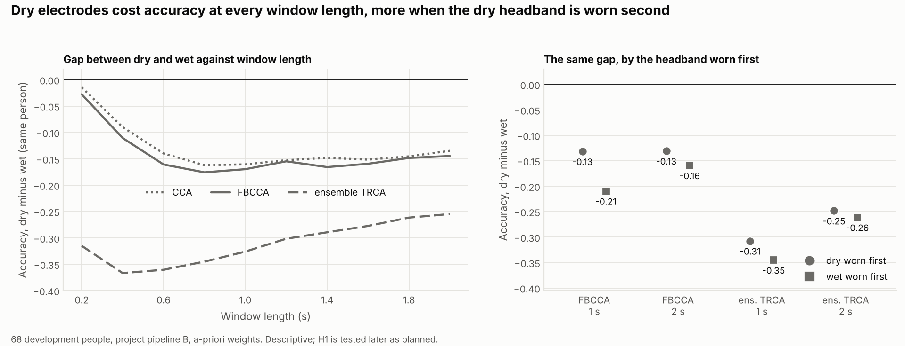
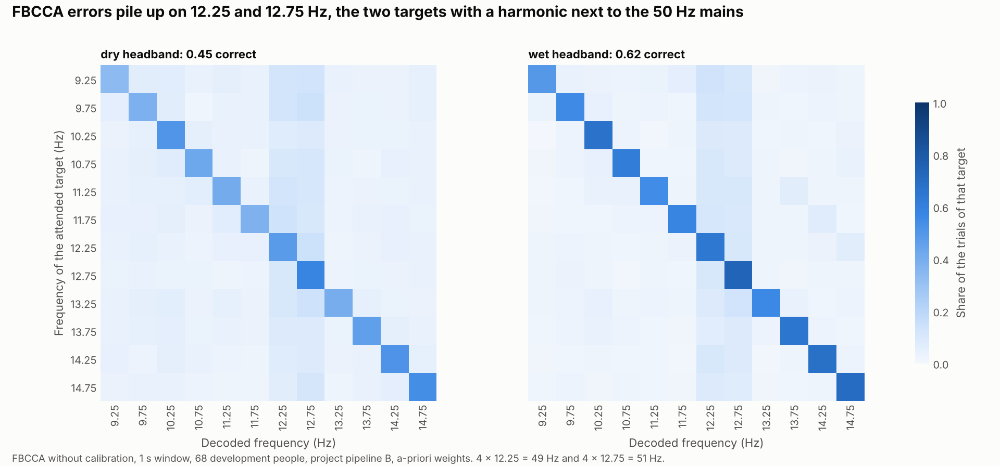

# M1 baselines: standard decoders on the wearable dataset

*13 Nov 2026. Plan: [`M1_plan.md`](M1_plan.md), approved by the author before anything was run. Only the 68
development people of the wearable dataset were loaded (the 34 lockbox people were not); BETA, the reference
dataset, has no lockbox and all its 70 people were used. Descriptive statistics only, no hypothesis test.
Every number below is recomputed by `scripts/m1_summary.py` (`logs/m1_summary.log`),
`scripts/m1_decision_bias.py` (`logs/m1_decision_bias.log`) and `scripts/m1_beta_summary.py`
(`logs/m1_beta_summary.log`). "Post hoc" marks what was added after the first results were seen. The BETA
part (section 3.4) was added later the same day, after the author's decisions (section 11).*

## Result in short

1. **The pre-registered reproduction gate failed.** With the filtering convention chosen for the gate (cut the
   window, then filter; mains kept), none of the ten published accuracies is reproduced within 0.05. CCA and
   FBCCA are 0.05 to 0.10 below the paper. Ensemble TRCA with the dry headband is close to chance (0.14
   against a published 0.62; chance is 0.08).
2. **The implementations are right.** The unit tests pass, and a second, literal implementation (textbook CCA
   and a line-by-line port of the public reference code) gives the same decision on all 960 trials compared.
3. **The cause is the filtering, in two parts** (section 3):
   - Mains interference is inside the pass-band of every sub-band. TRCA cannot cope with it on this
     unshielded recording. Removing the mains takes ensemble TRCA at 1 s from 0.13 to 0.46 (dry) and from
     0.51 to 0.84 (wet).
   - The published values are matched only when the **whole 2.84 s epoch** is filtered before the window is
     cut (and the mains removed): 9 of the 10 gate values and 13 of the 14 published values are then within
     0.05. This uses samples recorded after the end of the window, which a real-time system does not have.
4. **Dry or wet is settled.** Wet is above dry in all six comparisons (gate G4): position 1 is the dry headband.
5. **With the project pipeline (no future sample), on the development people:** FBCCA without calibration
   reaches 0.45 (dry) and 0.62 (wet) at 1 s, 0.68 and 0.83 at 2 s. Ensemble TRCA with per-person calibration
   reaches 0.52 and 0.84 at 1 s. With the dry headband 4 to 7 of the 68 people are not above chance at 1 s.
6. **Dry electrodes cost 0.15 to 0.17 in accuracy with FBCCA and 0.26 to 0.33 with ensemble TRCA** (same
   person). In time: the dry headband needs 1.06 s to reach what the wet one reaches in 0.6 s.
7. **A flaw was found in the mains-removal step of the project pipeline** (post hoc, section 7). It chooses
   the mains frequency for each channel separately. This creates a small narrow-band artefact that CCA locks
   onto: 21 % (dry) and 25 % (wet) of the CCA decisions, and 29 to 30 % of the FBCCA decisions, go to the two
   targets whose 4th harmonic is next to 50 Hz (12.25 and 12.75 Hz), where about 15 % is expected. A
   correction is proposed for the M2 plan; the M1 numbers are reported as planned, with the flaw.
8. **On BETA, the reference dataset, the gate passes (G5, 3 of 3).** With the same code and the reference
   convention, the published peak rates are reproduced within 4 %: CCA 70.2 bits/min (published 72.5), FBCCA
   96.8 (98.8), ensemble TRCA 139.9 (139.6). BETA was recorded with a laboratory amplifier that removes the
   mains, and there the filtering convention changes accuracy by 0.04 at most. This is independent evidence
   that the decoders are right and that the failure on the wearable data comes from its interference.

The author's decisions of 13 Nov 2026 are in section 11.

## Reproduction gate

Variant A (reference convention), 68 development people, against the published means of 102 people.

| | Method | Window | Headband | Published | Ours | Difference | Within 0.05 |
|---|---|---|---|---|---|---|---|
| G1 | CCA, 5 harmonics | 1 s | dry | 0.497 | 0.424 | -0.073 | no |
| G1 | | 1 s | wet | 0.684 | 0.609 | -0.075 | no |
| G2 | FBCCA, published weights | 1 s | dry | 0.53 | 0.430 | -0.100 | no |
| G2 | | 1 s | wet | 0.73 | 0.635 | -0.095 | no |
| G2 | | 2 s | dry | 0.73 | 0.642 | -0.088 | no |
| G2 | | 2 s | wet | 0.86 | 0.806 | -0.054 | no |
| G3 | Ensemble TRCA with filter bank, published weights | 1 s | dry | 0.62 | 0.141 | -0.479 | no |
| G3 | | 1 s | wet | 0.88 | 0.558 | -0.322 | no |
| G3 | | 2 s | dry | 0.73 | 0.136 | -0.594 | no |
| G3 | | 2 s | wet | 0.93 | 0.562 | -0.368 | no |

| Gate | Result |
|---|---|
| G1 CCA | **Fail**, 0 of 2 |
| G2 FBCCA | **Fail**, 0 of 4 |
| G3 TRCA | **Fail**, 0 of 4 |
| G4 wet above dry (CCA, FBCCA, ensemble TRCA at 1 s and 2 s) | **Pass**, 6 of 6 |
| G5 BETA: peak ITR of CCA, FBCCA and ensemble TRCA within 10 %, at the same window +/- 0.2 s | **Pass**, 3 of 3 (section 3.4) |

The plan says what happens then: no tuning to reach a target; the implementation is checked against the unit
tests and the reference code; the difference is documented; the author decides how to go on. Sections 2 and 3
are that check.

## 1. What was run

- Methods: CCA (sub-band 1), FBCCA, TRCA and ensemble TRCA with filter bank. FBCCA and TRCA with a-priori
  weights (`a = 1.25, b = 0.25`, 5 sub-bands) and with the weights published for this dataset.
- TRCA: leave-one-block-out, 10 folds; spatial filters and templates from the 9 training blocks only.
- Windows 0.2 to 2.0 s, starting 0.14 s after stimulus onset. 68 people x 2 headbands x 120 trials.
- Three filtering variants fixed in the plan, and two added post hoc to find the cause of the failure (D2):

| Variant | What the filter is given | Mains (50 Hz) | Uses samples after the window | Status |
|---|---|---|---|---|
| A | the window only (cut, then filter) | kept | no | reference code; **gate** |
| B | past samples + window | removed by least squares | no | **project pipeline** |
| C | whole 2.84 s epoch | removed by least squares | **yes** | diagnostic |
| A+ | the window only | removed | no | post hoc |
| C- | whole epoch | kept | yes | post hoc |

## 2. Is the implementation right?

- **Unit tests** on synthetic signals, written and passing before the data were used (commit `8ae6e04`): CCA
  equal to the textbook formula; chance level on noise; TRCA recovers a planted source; a marker planted in
  the held-out block never reaches the templates or the filters (with a positive control); shuffled training
  labels give chance; filter coefficients and gains of every sub-band; variants A, A+ and B do not change
  when the samples after the window change, C and C- do.
- **Second implementation** (`scripts/m1_crosscheck.py`, post hoc, person S001): CCA written literally from
  the covariance formula, and TRCA ported line by line from the public MATLAB reference code
  (`trca.m`, `train_model.m`, `test_model.m`). Same decision on 960 of 960 trials. CCA correlations agree to
  1e-13. Ensemble TRCA correlations differ by at most 0.006 (a difference in how the signals are centred),
  which changes no decision.
- **Shape of the results.** CCA against the number of harmonics rises and flattens exactly as in the paper's
  Figure 6a, 0.05 to 0.08 lower throughout (variant A, dry: ours 0.38, 0.42, 0.43, 0.43, 0.42, 0.42; published
  0.43, 0.48, 0.49, 0.49, 0.50, 0.50).

So the gap is not a programming error in the decoders. It comes from what the decoders are given.

## 3. Why the gate failed

### 3.1 The published values against the five variants

| Method | Window | Headband | Published | A | A+ | B | C- | C |
|---|---|---|---|---|---|---|---|---|
| CCA | 1 s | dry | 0.497 | 0.424 | 0.453 | 0.460 | 0.439 | **0.494** |
| | 1 s | wet | 0.684 | 0.609 | 0.609 | 0.621 | 0.626 | **0.657** |
| FBCCA, published weights | 0.2 s | dry | 0.12 | 0.082 | 0.110 | 0.112 | 0.082 | **0.123** |
| | 0.2 s | wet | 0.16 | 0.099 | 0.128 | 0.139 | 0.103 | **0.164** |
| | 1 s | dry | 0.53 | 0.430 | 0.453 | 0.461 | 0.444 | **0.499** |
| | 1 s | wet | 0.73 | 0.635 | 0.625 | 0.637 | 0.648 | **0.686** |
| | 2 s | dry | 0.73 | 0.642 | 0.681 | 0.691 | 0.645 | **0.698** |
| | 2 s | wet | 0.86 | 0.806 | 0.819 | 0.833 | 0.810 | **0.838** |
| Ensemble TRCA, published weights | 0.2 s | dry | 0.38 | 0.136 | 0.280 | 0.300 | 0.142 | **0.429** |
| | 0.2 s | wet | 0.66 | 0.453 | 0.590 | 0.605 | 0.477 | **0.644** |
| | 1 s | dry | 0.62 | 0.141 | 0.480 | 0.539 | 0.144 | 0.673 |
| | 1 s | wet | 0.88 | 0.558 | 0.845 | 0.847 | 0.560 | **0.857** |
| | 2 s | dry | 0.73 | 0.136 | 0.616 | 0.673 | 0.137 | **0.764** |
| | 2 s | wet | 0.93 | 0.562 | 0.897 | 0.902 | 0.561 | **0.906** |

Bold: within 0.05 of the published value.

| Variant | Gate values (G1-G3) within 0.05 | All 14 published values within 0.05 | Largest deviation |
|---|---|---|---|
| A (the gate) | 0 of 10 | 1 of 14 | 0.594 |
| A+ | 5 of 10 | 7 of 14 | 0.140 |
| B (project) | 5 of 10 | 7 of 14 | 0.093 |
| C- | 1 of 10 | 2 of 14 | 0.593 |
| **C** | **9 of 10** | **13 of 14** | 0.053 |

Only A was the pre-registered gate. The table applies the same criterion to the other variants to locate the
cause; it does not turn the failure into a pass.

### 3.2 Two causes, separated

Accuracy at 1 s, a-priori weights:

| Method | Headband | Mains kept, window only (A) | Mains kept, whole epoch (C-) | Mains removed, window only (A+) | Mains removed, past + window (B) | Mains removed, whole epoch (C) |
|---|---|---|---|---|---|---|
| FBCCA | dry | 0.422 | 0.431 | 0.445 | 0.451 | 0.488 |
| FBCCA | wet | 0.623 | 0.636 | 0.610 | 0.621 | 0.674 |
| Ensemble TRCA | dry | 0.130 | 0.132 | 0.456 | 0.515 | 0.655 |
| Ensemble TRCA | wet | 0.507 | 0.511 | 0.840 | 0.841 | 0.851 |

**Cause 1: the mains component breaks TRCA.** The filter bank of the reference code passes 6 to 90 Hz, so
50 Hz is inside every sub-band. In M0 the median mains pick-up was 67 µV (dry) and 12 µV (wet), against a
response of a few microvolts (about 2.5 µV at Oz). TRCA builds its template by averaging the 9 calibration
trials of a target. The mains has a different phase in every trial, so averaging 9 trials divides it by
about 3 only: about 22 µV of mains is left in a dry template, roughly ten times the response. The spatial
filters and the templates then describe the mains, not the response. Whatever the context of the filter,
ensemble TRCA stays at 0.13 (dry) and 0.51 (wet) while the mains is kept, and jumps as soon as it is
removed. CCA and FBCCA change by 0.03 at most: their references contain no 50 Hz, and their spatial filter
can cancel a component common to the channels.

**Cause 2: the filter needs context, and the published values need future samples.** A zero-phase filter
applied to a short window produces an error at both ends of the window. The synthetic test done before the
data (figure below; `results/m1/edge_transients.csv`) measured it: with dry-like interference the error
inside a 1 s window is 9.5 µV for A, 2.4 µV for B and 0.7 µV for C, for a response of 1.5 µV. On the
recordings, giving the filter the whole epoch instead of the past samples only (C against B) adds 0.10 to
0.17 to ensemble TRCA with the dry headband at every window length, at most 0.04 with the wet one, and at
most 0.05 to CCA and FBCCA.

### 3.3 What this shows and what it does not

- The paper does not describe how the decoding analysis was filtered: no mains removal, no filter design, and
  no statement on whether windows were cut before or after filtering. We do not know what its authors did.
  What we can say is that variant C reproduces their numbers and the other four variants do not.
- With variant C our ITR in the paper's convention (window only, no gaze shift) is also close to the
  published peaks: FBCCA 67.7 bits/min at 1.2 s (dry; published 72.3 at 1.2 s) and 114.3 at 0.6 s (wet; 125.6
  at 0.8 s); TRCA 241.9 at 0.2 s (dry; 201.2 at 0.2 s) and 479.7 at 0.2 s (wet; 499.5 at 0.2 s).
- In C the filter sees 0.2 s to 2.0 s of signal recorded after the end of the window (more for short
  windows). The published accuracies for short windows are therefore not reachable by a real-time decoder that
  uses this filter bank as it is. With the dry headband the difference is large: ensemble TRCA at 1 s gives
  0.66 with the whole epoch and 0.52 without future samples.
- The paper does not say whether its TRCA is the plain or the ensemble form. With variant C and the
  published weights, the plain form matches the published dry values almost exactly (0.370, 0.616, 0.728
  against 0.38, 0.62, 0.73 at 0.2, 1 and 2 s) and falls short for wet (0.583, 0.824, 0.883 against 0.66,
  0.88, 0.93); the ensemble form is 0.03 to 0.05 above for dry and 0.02 below for wet. Neither form fits both.
- Our means are over 68 people and the published ones over 102. This can explain about 0.02, not the gaps of
  variant A.

### 3.4 Independent check on BETA (gate G5)

BETA (Liu et al. 2020): 70 people, 40 targets, 4 blocks, laboratory amplifier with a 50 Hz notch, files
already band-passed (3-100 Hz) by the authors. Nine channels as in the BETA paper, window from 0.13 s after
stimulus onset, 5 harmonics, a-priori weights (also the BETA paper's), leave-one-block-out for TRCA, ITR with
a gaze shift of 0.55 s. Data check first (`logs/m1_beta_check.log`): all values finite, the same frequency
table in every file, each of the 40 targets peaks at its own frequency in the group average at Oz, no mains
component (0.13 µV at 50 Hz against 0.37 µV around it).

| | Method | Published peak ITR (bits/min) | Ours, variant A (SEM) | Difference | Passes |
|---|---|---|---|---|---|
| G5 | CCA (6-80 Hz) | 72.5 at 1.8 s | 70.2 (4.6) at 1.8 s | -3.2 % | yes |
| G5 | FBCCA | 98.8 at 1.4 s | 96.8 (4.0) at 1.6 s; 96.7 at 1.4 s | -2.0 % | yes |
| G5 | Ensemble TRCA with filter bank | 139.6 at 0.6 s | 139.9 (8.3) at 0.6 s | +0.2 % | yes |

- Mean accuracy at 1 s (variant A): CCA 0.386, FBCCA 0.568, TRCA 0.637, ensemble TRCA 0.761. At 2 s: 0.682,
  0.823, 0.781, 0.863. With FBCCA and ensemble TRCA nobody is at chance at 1 s or 2 s (40 targets, chance
  0.025).
- **Here the filtering convention hardly matters.** Filtering the whole trial instead of the cut window
  changes accuracy by 0.04 at most (ensemble TRCA at 0.2 s) and by 0.02 at most from 1 s on; the peak rates
  become 71.1, 98.5 and 143.6 bits/min. The files contain no mains and no drift, so a short window has little
  to produce an edge error from.
- Reading the two datasets together: the same decoders, with the same convention, reproduce the published
  results on clean laboratory data and fall 0.05 to 0.6 short on the unshielded wearable data, where the
  shortfall disappears once the mains is removed and the whole epoch is filtered. The failed gate G1-G3 is
  therefore about how the wearable recordings were filtered, not about the decoders.
- Limits: the BETA paper evaluated S16-S70 with windows up to 3 s; ours stop at 2 s, which covers the three
  published peaks. The phase table stored in the files differs from the paper by a constant (the authors'
  correction of June 2022); these decoders do not use it.

## 4. Results with the project pipeline (variant B)

Mean accuracy over the 68 development people (standard error in brackets), a-priori weights. Chance is 0.083.

| Method | Headband | 0.2 s | 0.6 s | 1.0 s | 1.4 s | 2.0 s |
|---|---|---|---|---|---|---|
| CCA | dry | 0.107 (0.004) | 0.316 (0.025) | 0.460 (0.032) | 0.582 (0.033) | 0.682 (0.032) |
| CCA | wet | 0.122 (0.005) | 0.456 (0.027) | 0.621 (0.031) | 0.730 (0.029) | 0.817 (0.024) |
| FBCCA (no calibration) | dry | 0.110 (0.005) | 0.315 (0.025) | 0.451 (0.031) | 0.567 (0.033) | 0.681 (0.032) |
| FBCCA (no calibration) | wet | 0.137 (0.007) | 0.475 (0.030) | 0.621 (0.032) | 0.732 (0.029) | 0.826 (0.023) |
| TRCA (per-person calibration) | dry | 0.214 (0.020) | 0.313 (0.030) | 0.388 (0.033) | 0.453 (0.035) | 0.519 (0.035) |
| TRCA (per-person calibration) | wet | 0.540 (0.031) | 0.735 (0.032) | 0.801 (0.030) | 0.832 (0.029) | 0.867 (0.025) |
| Ensemble TRCA (per-person calibration) | dry | 0.287 (0.025) | 0.427 (0.033) | 0.515 (0.034) | 0.587 (0.035) | 0.643 (0.035) |
| Ensemble TRCA (per-person calibration) | wet | 0.601 (0.029) | 0.788 (0.027) | 0.841 (0.025) | 0.876 (0.021) | 0.898 (0.019) |

- **Calibration helps a lot with wet electrodes and little with dry ones.** At 1 s ensemble TRCA is 0.22 above
  FBCCA with the wet headband and 0.06 above with the dry one. At 2 s with the dry headband it is below FBCCA
  (0.643 against 0.681).
- **The filter bank adds almost nothing here.** FBCCA is within 0.01 of plain CCA at 1 s and 2 s. In the
  paper it adds 0.03 to 0.05. The flaw of section 7 touches the upper sub-bands most, so this may change once
  it is corrected.
- **Optimism of the published weights is small.** They were tuned on the same recordings. Against the
  a-priori weights they add at most 0.02 to FBCCA, 0.01 to 0.03 to ensemble TRCA with the dry headband, and
  less than 0.01 with the wet one.

**Speed.** Information transfer rate with 0.5 s to move the eyes to the next target (per person, then averaged):

| Method | Headband | Peak ITR (bits/min) | At window |
|---|---|---|---|
| CCA | dry / wet | 44.7 / 64.7 | 1.6 s / 1.2 s |
| FBCCA | dry / wet | 44.8 / 64.6 | 1.8 s / 1.6 s |
| Ensemble TRCA | dry / wet | 47.8 / 140.0 | 1.2 s / 0.4 s |

The paper computes ITR with the window alone as the selection time. In that convention our pipeline B gives
59.7 (FBCCA dry), 96.6 (FBCCA wet), 118.8 (TRCA dry) and 428.0 bits/min (TRCA wet), the last two at 0.2 s.
A rate obtained at 0.2 s with no time to look at the next target is not a usable speed, which is why the
project value includes the gaze shift.

## 5. People

| Method, window | Not above chance (below 0.133), dry | wet | At 0.9 or more, dry | wet |
|---|---|---|---|---|
| FBCCA, 1 s | 4 of 68 | 3 of 68 | 5 | 11 |
| FBCCA, 2 s | 2 | 0 | 21 | 36 |
| Ensemble TRCA, 1 s | 7 | 0 | 11 | 38 |
| Ensemble TRCA, 2 s | 6 | 0 | 19 | 47 |

- Accuracy differs between people far more than between methods: with one headband and one method it goes
  from chance to 1.0.
- It follows the single-trial SNR at Oz measured in M0 without any decoder (Spearman 0.56 to 0.65).
- With the dry headband some people stay at chance even with per-person calibration and 2 s of data.

## 6. Dry against wet (descriptive; H1 is tested later, as planned)

Same person, dry minus wet, pipeline B, a-priori weights:

| Method | Window | Mean difference | Dry lower in | Dry worn first (35 people) | Wet worn first (33 people) |
|---|---|---|---|---|---|
| FBCCA | 1 s | -0.170 | 56 of 68 | -0.132 | -0.210 |
| FBCCA | 2 s | -0.145 | 52 of 68 | -0.131 | -0.159 |
| Ensemble TRCA | 1 s | -0.326 | 62 of 68 | -0.308 | -0.345 |
| Ensemble TRCA | 2 s | -0.255 | 57 of 68 | -0.248 | -0.261 |

- The gap is there for both orders of wearing. It is larger when the dry headband comes second, which is the
  order effect expected from M0 (the second headband tends to be worse): 0.01 to 0.04 of the gap.
- For FBCCA the gap stays between -0.18 and -0.15 from 0.6 to 2.0 s; it hardly shrinks. For ensemble
  TRCA it shrinks from -0.37 at 0.4 s to -0.26 at 2.0 s. This is why H1 makes no claim about the trend.
- **Time cost of dry electrodes (FBCCA):** to reach the mean accuracy the wet headband has at 0.4, 0.6, 0.8
  and 1.0 s, the dry one needs 0.66, 1.06, 1.36 and 1.61 s. What the wet headband reaches at 1.2 s the dry
  one does not reach within 2 s. With ensemble TRCA the dry headband does not reach within 2 s what the wet
  one has at 0.4 s.

## 7. Errors, and a flaw in the mains-removal step (post hoc)

**Observation.** With FBCCA at 1 s the errors do not go mainly to neighbouring frequencies (21 to 22 % of the
errors go to a target 0.5 Hz away; 17 % would by chance). They pile up on two targets: 12.25 and 12.75 Hz
receive 36 % (dry) and 48 % (wet) of all errors, and 29 to 30 % of all decisions instead of 17 %. Ensemble
TRCA shows nothing of the kind.

**Explanation tested.** The 4th harmonic of these two targets is 49 and 51 Hz, the two frequencies next to
the mains. `scripts/m1_decision_bias.py` runs plain CCA at 1 s with different sets of reference harmonics.
Share of the decisions that go to 12.25 or 12.75 Hz (these two get about 0.15 when nothing is wrong, because
CCA favours the low targets):

| Mains | Variant | Headband | Harmonics 1-3 | 1-4 | 1-5 | 1-3 and 5 |
|---|---|---|---|---|---|---|
| kept | A | dry / wet | 0.140 / 0.153 | 0.162 / 0.159 | 0.151 / 0.152 | 0.130 / 0.147 |
| removed, frequency chosen per channel | B | dry / wet | 0.137 / 0.158 | 0.229 / 0.258 | 0.212 / 0.248 | 0.128 / 0.152 |
| removed, frequency chosen per channel | C | dry / wet | 0.140 / 0.160 | 0.195 / 0.202 | 0.185 / 0.198 | 0.134 / 0.159 |
| removed, one frequency per trial (test only) | B* | dry / wet | 0.138 / 0.157 | 0.203 / 0.189 | 0.190 / 0.181 | 0.131 / 0.154 |
| removed, one frequency per trial (test only) | C* | dry / wet | 0.139 / 0.160 | 0.182 / 0.168 | 0.174 / 0.165 | 0.134 / 0.160 |

- The excess appears only when the 4th harmonic is among the references, and only when the mains has been
  **removed**. With the mains kept it is 0.02 at most. So it is produced by our removal step, not by the
  mains itself.
- The single-channel spectrum shows nothing: after the removal the amplitude at 49 and 51 Hz is not above
  that at 47, 48, 52 and 53 Hz (ratio 0.99 dry, 0.93 wet). The artefact is small in each channel. It matters
  because CCA is free to choose the combination of channels in which it is largest.
- **Two mechanisms, both reproduced on synthetic epochs that contain no response at all:**
  1. *Frequency chosen per channel.* `remove_mains` searches the mains frequency for each channel separately,
     so each channel gets a slightly different operation. The differences between channels are pure
     narrow-band signals around 50 Hz. On synthetic noise **without any mains**, 35 to 76 % of the decisions
     then go to the two targets; with one frequency per trial for all channels, 6 % (the same as without
     removal). On the recordings the shared frequency brings the wet headband, where the mains is weak and
     the per-channel choice is driven by noise, from 0.248 back to 0.181.
  2. *Mains that is not steady.* If the amplitude of the mains wanders by a few percent within the epoch, the
     removal takes out the carrier and leaves the wander, which lies right beside 50 Hz. On synthetic epochs
     with strong wandering mains 24 to 27 % of the decisions go to the two targets, with or without the
     shared frequency. This is the likely reason why an excess remains with the dry headband, where the
     mains is strong (0.190 with the shared frequency); it was not tested further.
- **Size of the effect on accuracy** (plain CCA, 1 s, pipeline B): leaving the 4th and 5th harmonics out gives
  0.479 (dry) and 0.651 (wet) instead of 0.460 and 0.621; the shared frequency alone gives 0.465 and 0.653.

**What it means.** The removal step was designed in M0 for single-channel spectra (deviation D1 of M0), where
it is sound. Used before a decoder that combines channels it has this side effect. The M1 numbers of
variants A+, B and C contain it. The baselines are therefore somewhat pessimistic for CCA and FBCCA; the
effect on TRCA was not measured. Nothing was changed in M1 because of it: the correction and the choice of
harmonics belong to the M2 plan, to be approved first (section 9).

Other points on errors: accuracy by target with FBCCA at 1 s is lowest at 9.25 Hz (0.34 dry, 0.50 wet) and
highest at 12.75 Hz (0.58, 0.74); the second is inflated by the bias above.

## 8. Cost

Time of one decision at 1 s on one core of the analysis machine (`results/m1/compute_time.csv`; a second
run gave values within 20 % of these):

| Step | Milliseconds |
|---|---|
| Preprocessing, variant B (mains removal with frequency search + 5 sub-bands) | 6.3 |
| Preprocessing, variant A (5 sub-bands) | 0.85 |
| CCA, 12 targets | 0.19 |
| FBCCA, 12 targets, 5 sub-bands | 0.61 |
| Ensemble TRCA scoring, 12 targets, 5 sub-bands | 1.3 |

FBCCA learns nothing from data (two fixed weight parameters). Ensemble TRCA stores, per person, 5 sub-bands
x 12 targets x (8 filter weights + a template of 8 channels x window): 120 480 numbers for a 1 s window,
learned from 108 calibration trials (9 blocks x 12 targets).

## 9. What M1 changes for the next milestones

Proposals for the M2 plan. None is applied yet; each needs the author's approval.

1. **Mains removal:** one mains frequency per trial, shared by all channels (the same linear operation on
   every channel), and a decision on the harmonics next to 50 Hz (leave them out of the references, or limit
   the band below the mains). Then the baselines are re-run once with the corrected pipeline, and the M1
   numbers stay in this report as they are.
2. **Mains removal is not optional for TRCA-like methods on this dataset.** Any method that learns spatial
   filters or templates from few trials needs it.
3. **Filter context:** B's remaining error is at the end of the window (5.7 µV in the last 0.1 s against
   1.0 µV in the first 0.1 s, synthetic dry-like case). A forward-only filter has no error at the end of the
   window (it has a delay instead) and is what a real-time system would run; it can be compared with B in M2.
4. **Published results as a yardstick:** from now on the project compares with its own baselines run under
   the same pipeline. The published numbers of this dataset are quoted with the remark of section 3.3.
5. **The filter bank** brings almost nothing with the a-priori weights here; M2 should not assume it helps.
6. **People at chance** exist with both headbands; results will keep reporting the distribution, not the mean
   only.

## 10. Deviations from the M1 plan

| | Deviation | Why |
|---|---|---|
| D1 | BETA was analysed from reduced files (nine channels, single precision; `scripts/beta_reduce.py`), after the wearable part and after the author's decisions. Variants: A (the gate) and whole-trial filtering without mains removal; B and C were not run on BETA. | The 5.3 GB could not be copied; the reduction ran on the author's computer and the 0.4 GB were copied. The reduced and the original files give the same numbers (unit test; checked on S1). The amplifier removed the mains, so the mains removal of B and C has no object. Only a smoke test on two people preceded the commit of the BETA code. |
| D2 | Two filtering variants were added after the gate failed: A+ (A with mains removed) and C- (C with mains kept). They are stored in a separate file (`wearable_accuracy_diagnostic.csv`). | To separate the effect of the mains from the effect of the filter context. They are not part of the gate. |
| D3 | Variant C removes the mains before filtering, like B. The plan only said "filter the full epoch, then cut". | So that B and C differ by the context alone. Fixed in the code committed before the data (`8ae6e04`). |
| D4 | Sub-bands are combined for TRCA as `sum_n w(n) * sign(r_n) * r_n^2`, not `r_n^2`. | This is what the reference implementation does; a negative correlation with a template should not count as evidence for it. Fixed before the data. |
| D5 | A second, literal implementation was run on one person (`m1_crosscheck.py`). | Required by the plan's rule after a failed gate. |
| D6 | A diagnostic of the decision bias was added (`m1_decision_bias.py`): CCA with other sets of harmonics, a spectrum near the mains, synthetic epochs, and a removal with one frequency per trial (B*, C*, in that script only). | To explain the confusion matrix. Post hoc; it changes no M1 result. |
| D7 | Our ITR is also given in the paper's convention (window alone) for variants A and C. | To compare with the published peaks. |

Nothing was tuned. No weight, band, harmonic count or window was chosen from these results. No lockbox
person was loaded.

## 11. Decisions of the author (13 Nov 2026)

Three questions were put to the author with the wearable results, before the BETA part was run:

1. **The failed gate.** Decision: the diagnosis is accepted, the gate stays recorded as failed (G1 to G3),
   and the project goes on with a pipeline that uses no sample after the window.
2. **The correction of the mains removal** (section 9, point 1). Decision: part of the M2 plan, with one
   re-run of the baselines.
3. **BETA.** Decision: gate G5 is kept; the dataset is reduced on the author's computer. Done: section 3.4.

## 12. Files

- Code: `src/ssvep/filterbank.py`, `decoders.py`, `metrics.py`, `beta.py`; tests in `tests/`.
- Scripts: `scripts/m1_edge_transients.py` (synthetic, before the data), `m1_baselines_wearable.py`
  (`--diagnostic` for A+ and C-), `m1_crosscheck.py`, `m1_decision_bias.py`, `m1_summary.py`, `m1_figures.py`;
  BETA: `beta_reduce.py`, `m1_beta_check.py`, `m1_baselines_beta.py`, `m1_beta_summary.py`.
- Tables: `results/m1/` (`gate.csv`, `published_comparison.csv`, `gate_other_variants.csv`,
  `wearable_accuracy.csv` with one row per person, headband, variant, method and window,
  `wearable_accuracy_by_block.csv`, `accuracy_summary.csv`, `mains_by_context_1s.csv`,
  `variant_differences.csv`, `dry_minus_wet_by_window.csv`, `dry_minus_wet_by_order.csv`,
  `wearable_confusion_1s.csv`, `decision_bias_1s.csv`, `decision_bias_synthetic.csv`,
  `amplitude_near_mains_1s.csv`, `edge_transients.csv`, `crosscheck.csv`, `compute_time.csv`; BETA:
  `beta_accuracy.csv`, `beta_summary.csv`, `gate_beta.csv`, `beta_check.csv`, `beta_group_amplitude_oz.csv`).
- Figures: `figures/m1/01` to `08`. Logs: `logs/m1_*.log`.
