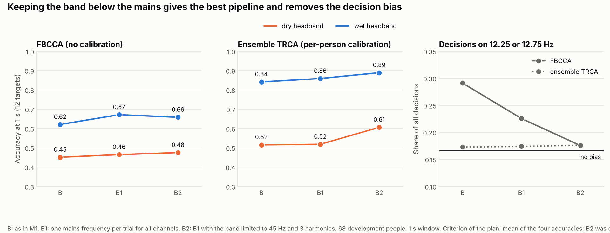
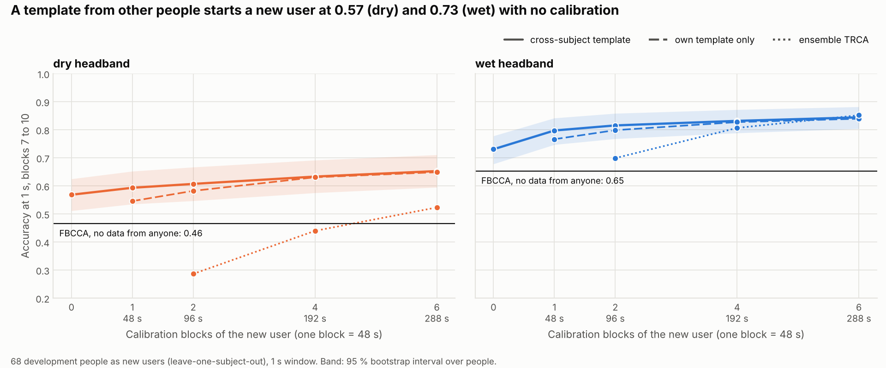
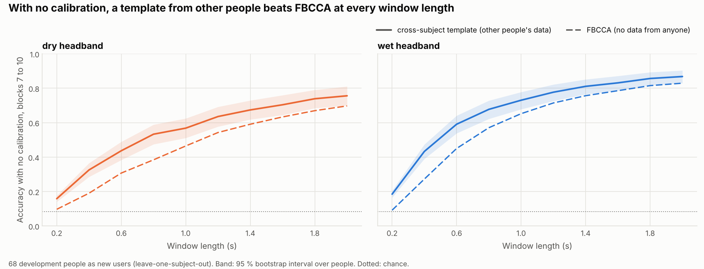
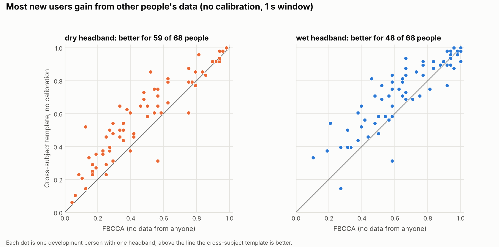

# M2: new users and calibration

*13 Nov 2026. Plan: [`M2_plan.md`](M2_plan.md), approved by the author before anything was run. Only the 68
development people were loaded; the 34 lockbox people were not. Every person is treated as a new user: the
population never contains their data (leave-one-subject-out). Descriptive statistics only, with 95 %
bootstrap intervals over people; **no p-value**, because the tests of H1 and H2 are reserved for the lockbox.
Every number below is recomputed by `scripts/m2_summary.py` (`logs/m2_summary.log`).*

## Result in short

1. **Pipeline frozen: B2.** One mains frequency per trial for all channels, band limited to 45 Hz, three
   harmonics. It won the criterion fixed in the plan (0.657 against 0.628 for B1 and 0.607 for the M1
   pipeline) and it removes the decision bias found in M1 (FBCCA decisions on 12.25 or 12.75 Hz: 0.29 with
   the M1 pipeline, 0.18 now, 0.17 without bias).
2. **With no calibration at all, a template built from other people beats FBCCA** at every window length.
   At 1 s: 0.57 against 0.47 with the dry headband (+0.10, interval 0.08 to 0.13; better for 59 of 68
   people) and 0.73 against 0.65 with the wet one (+0.08, interval 0.05 to 0.10; 48 of 68).
3. **A few of the user's own blocks add to it:** 0.61 (dry) and 0.82 (wet) with two blocks (96 s), 0.65 and
   0.84 with six. Other people's data help most when the user has given little: +0.05 (dry) and +0.03 (wet)
   at one block, nothing from four blocks on.
4. **Per-person calibration with ensemble TRCA needs many blocks,** and with dry electrodes it stays behind:
   0.29 (dry) and 0.70 (wet) with two blocks, 0.52 and 0.85 with six.
5. **H2 on the development people** (cross-subject template with 2 blocks against ensemble TRCA with 6, at
   1 s): with the dry headband the template is 0.08 **above** (interval +0.04 to +0.13). With the wet one it
   is 0.04 below (interval -0.06 to -0.02), which does not exclude the margin of 0.05. The test itself is
   run on the lockbox.
6. **Dry electrodes still cost accuracy with the frozen pipeline:** FBCCA -0.18 at 1 s and -0.13 at 2 s,
   ensemble TRCA -0.28 and -0.20 (same person; the crossover estimates are the same to 0.001).
7. The lockbox is untouched. The pipeline and one setting (`n0`) were chosen on the development people, so
   the development numbers are slightly optimistic; the lockbox will say by how much.

## 1. Step 0: choice of the pipeline

Accuracy at 1 s, a-priori weights, FBCCA and ensemble TRCA (leave-one-block-out):

| Candidate | FBCCA dry | FBCCA wet | Ens. TRCA dry | Ens. TRCA wet | **Criterion** (mean) | FBCCA decisions on 12.25 or 12.75 Hz |
|---|---|---|---|---|---|---|
| B: as in M1 | 0.451 | 0.621 | 0.515 | 0.841 | 0.607 | 0.291 |
| B1: one mains frequency per trial | 0.465 | 0.671 | 0.518 | 0.859 | 0.628 | 0.226 |
| **B2: B1 + band to 45 Hz, 3 harmonics** | 0.475 | 0.658 | 0.606 | 0.889 | **0.657** | 0.176 |

- B reproduces the M1 numbers exactly, which checks the new code against the old one.
- B2 is 0.029 above B1 (the plan asked for at least 0.01), so **B2 is the project pipeline** from here on.
- The gain of B2 is in ensemble TRCA (better for 84 person-headbands, equal for 26, worse for 26; +0.059 on
  average). For FBCCA B2 and B1 are equal on average (-0.001). The shared mains frequency alone (B1) gives
  FBCCA +0.05 with the wet headband, where the per-channel choice was driven by noise.
- A point learned while writing the unit tests: the bias of the per-channel removal appears only when the
  channels are strongly correlated, as scalp channels are. With weakly correlated synthetic channels it is
  absent. A dated note was added to section 7 of the M1 report.

## 2. Baselines with the frozen pipeline (leave-one-block-out, all 10 blocks)

Mean accuracy over the 68 development people (standard error):

| Method | Headband | 0.2 s | 0.6 s | 1.0 s | 1.4 s | 2.0 s |
|---|---|---|---|---|---|---|
| CCA | dry | 0.100 (0.004) | 0.296 (0.023) | 0.463 (0.030) | 0.581 (0.032) | 0.691 (0.031) |
| CCA | wet | 0.100 (0.004) | 0.430 (0.023) | 0.634 (0.027) | 0.743 (0.026) | 0.816 (0.023) |
| FBCCA | dry | 0.102 (0.004) | 0.306 (0.024) | 0.475 (0.031) | 0.596 (0.031) | 0.702 (0.031) |
| FBCCA | wet | 0.103 (0.004) | 0.456 (0.025) | 0.658 (0.027) | 0.763 (0.025) | 0.836 (0.021) |
| TRCA | dry | 0.244 (0.022) | 0.381 (0.033) | 0.468 (0.034) | 0.546 (0.035) | 0.620 (0.036) |
| TRCA | wet | 0.531 (0.028) | 0.777 (0.027) | 0.856 (0.022) | 0.895 (0.019) | 0.925 (0.015) |
| Ensemble TRCA | dry | 0.331 (0.026) | 0.509 (0.033) | 0.606 (0.034) | 0.683 (0.033) | 0.741 (0.032) |
| Ensemble TRCA | wet | 0.612 (0.027) | 0.827 (0.021) | 0.889 (0.017) | 0.917 (0.015) | 0.940 (0.012) |

- Against the M1 pipeline: ensemble TRCA gains 0.08 to 0.10 with the dry headband and 0.04 to 0.05 with the
  wet one from 0.6 s on; FBCCA gains 0.01 to 0.04 from 1 s on and loses 0.01 to 0.03 at 0.2 and 0.6 s.
- Ensemble TRCA now stands at 0.74 (dry) and 0.94 (wet) at 2 s **without any sample after the window**. In
  M1 this level (published: 0.73 and 0.93) was reached only by filtering the whole epoch. The band is not the
  published one, so this is a comparison of levels, not a reproduction.
- Peak ITR (window + 0.5 s): FBCCA 46.7 (dry, 1.8 s) and 68.7 bits/min (wet, 1.2 s); ensemble TRCA 64.1
  (dry, 0.8 s) and 147.3 (wet, 0.4 s).
- People not above chance at 1 s: FBCCA 5 (dry) and 0 (wet) of 68; ensemble TRCA 5 and 0.
- Decisions on 12.25 or 12.75 Hz at 1 s: 0.17 to 0.18 for both methods and both headbands (0.167 without bias).

## 3. A new user: design and the one new setting

- Calibration = the first `k` blocks of the person (`k` = 0, 1, 2, 4, 6; one block = 48 s). Test = blocks 7
  to 10 (48 trials), the same for every method and every `k`. Population = the 67 other development people
  with the same type of headband.
- Methods on the same test trials: **FBCCA** (no data from anyone); **cross-subject template**
  `T_f = (n0 * P_f + k * I_f) / (n0 + k)` with the extended-CCA decision; **own template only** (the same
  decision with `T_f = I_f`); **ensemble TRCA** trained on the `k` calibration blocks.
- **`n0` = 4**, chosen by the rule of the plan (mean accuracy at 1 s over `k` = 1, 2, 4 and both headbands):
  0.697, 0.701, 0.709, **0.713**, 0.710 for `n0` = 0.5, 1, 2, 4, 8. The curve is flat: the choice hardly
  matters. The population template counts as four of the user's own blocks.

## 4. Calibration curve

Mean accuracy at 1 s, blocks 7 to 10 [95 % interval over people]:

| Headband | Method | `k` = 0 | 1 (48 s) | 2 (96 s) | 4 (192 s) | 6 (288 s) |
|---|---|---|---|---|---|---|
| dry | FBCCA | 0.465 [0.402, 0.523] | | | | |
| dry | Cross-subject template | 0.568 [0.511, 0.625] | 0.593 [0.535, 0.652] | 0.607 [0.547, 0.667] | 0.633 [0.575, 0.691] | 0.653 [0.595, 0.711] |
| dry | Own template only | | 0.546 [0.482, 0.607] | 0.582 [0.518, 0.643] | 0.631 [0.569, 0.691] | 0.649 [0.587, 0.711] |
| dry | Ensemble TRCA | | | 0.286 [0.230, 0.347] | 0.440 [0.372, 0.508] | 0.523 [0.455, 0.592] |
| wet | FBCCA | 0.652 [0.592, 0.709] | | | | |
| wet | Cross-subject template | 0.730 [0.678, 0.778] | 0.797 [0.747, 0.842] | 0.815 [0.768, 0.858] | 0.831 [0.788, 0.872] | 0.844 [0.804, 0.882] |
| wet | Own template only | | 0.766 [0.711, 0.817] | 0.798 [0.748, 0.846] | 0.827 [0.781, 0.868] | 0.839 [0.795, 0.878] |
| wet | Ensemble TRCA | | | 0.699 [0.635, 0.759] | 0.806 [0.753, 0.855] | 0.852 [0.807, 0.892] |

At 2 s the cross-subject template gives 0.756 (dry) and 0.868 (wet) with no calibration, 0.789 and 0.908
with two blocks, 0.808 and 0.923 with six; ensemble TRCA with six blocks gives 0.663 and 0.915.

- **What the population adds to the user's own blocks** (cross-subject minus own template, 1 s): +0.047
  [+0.033, +0.063] (dry) and +0.031 [+0.010, +0.052] (wet) at one block; +0.025 and +0.017 at two; +0.002 and
  +0.004 at four. Once a user has given four blocks, other people's data no longer matter.
- **One block of the user's own data is worth about as much as the population:** own template with one block
  0.546 (dry) and 0.766 (wet), population alone 0.568 and 0.730.
- **Ensemble TRCA is the wrong tool for short calibration.** With two blocks it is below FBCCA. With the dry
  headband it is still 0.13 below the template decoder after six blocks (0.523 against 0.649 for the own
  template); with the wet headband the two are level (0.852 against 0.839).
- **Speed** (best window, window + 0.5 s): with no calibration the cross-subject template gives 56.0 bits/min
  (dry, 1.2 s) and 79.8 (wet, 0.8 s), against 46.5 and 68.2 for FBCCA; with two blocks 63.9 and 100.7.
  Ensemble TRCA with six blocks gives 50.0 (dry) and 130.8 (wet, at 0.4 s).

## 5. No calibration: other people's data against FBCCA

Cross-subject template (`k` = 0) minus FBCCA, same trials, mean [95 % interval]:

| Window | Dry | People better / equal / worse | Wet | People better / equal / worse |
|---|---|---|---|---|
| 0.2 s | +0.062 [+0.042, +0.081] | 50 / 6 / 12 | +0.093 [+0.072, +0.115] | 54 / 9 / 5 |
| 0.6 s | +0.130 [+0.105, +0.154] | 58 / 3 / 7 | +0.141 [+0.109, +0.172] | 56 / 2 / 10 |
| 1.0 s | +0.104 [+0.077, +0.128] | 59 / 2 / 7 | +0.078 [+0.050, +0.104] | 48 / 7 / 13 |
| 1.4 s | +0.083 [+0.061, +0.105] | 50 / 13 / 5 | +0.054 [+0.027, +0.081] | 40 / 14 / 14 |
| 2.0 s | +0.059 [+0.041, +0.078] | 44 / 14 / 10 | +0.039 [+0.015, +0.061] | 37 / 18 / 13 |

- The gain is largest at short windows and for the people FBCCA decodes poorly: at 1 s, +0.13 (dry) and +0.12
  (wet) in the lower half of FBCCA accuracy, +0.07 and +0.03 in the upper half.
- It does not rescue everybody: with the dry headband 3 of 68 people stay at chance at 1 s (7 with FBCCA).
- A template says when the response comes (its phase), which the sine-cosine reference leaves free. This is
  the information other people's data bring.

## 6. H2 on the development people (descriptive)

H2: a cross-subject template with 2 calibration blocks (96 s) is not more than 0.05 below ensemble TRCA with
6 blocks (288 s), at 1 s.

| Headband | Window | Cross-subject, `k` = 2 | Ensemble TRCA, `k` = 6 | Difference [95 % interval] | Interval above -0.05 | People within 0.05 or better |
|---|---|---|---|---|---|---|
| dry | 1 s | 0.607 | 0.523 | +0.084 [+0.039, +0.130] | yes | 53 of 68 |
| wet | 1 s | 0.815 | 0.852 | -0.036 [-0.059, -0.015] | **no** | 44 of 68 |
| dry | 2 s | 0.789 | 0.663 | +0.126 [+0.087, +0.170] | yes | 65 of 68 |
| wet | 2 s | 0.908 | 0.915 | -0.007 [-0.026, +0.013] | yes | 55 of 68 |

- Dry: the template with a third of the calibration time is clearly better than full per-person TRCA.
- Wet at 1 s: on average the template is within the margin (-0.036), but the interval reaches -0.059. On
  these data H2 is not established for the wet headband at 1 s. The margin, the cases and the test stay as
  fixed in the plan; nothing is adjusted.
- These are development estimates. The verdict on H2 comes from the lockbox.

## 7. Dry against wet with the frozen pipeline (descriptive; H1 is tested on the lockbox)

| Method | Window | Mean dry - wet | Dry lower in | Dry worn first (35) | Wet worn first (33) | Crossover estimate |
|---|---|---|---|---|---|---|
| FBCCA | 1 s | -0.183 | 56 of 68 | -0.160 | -0.206 | -0.183 |
| FBCCA | 2 s | -0.134 | 49 of 68 | -0.113 | -0.156 | -0.134 |
| Ensemble TRCA | 1 s | -0.283 | 63 of 68 | -0.264 | -0.303 | -0.284 |
| Ensemble TRCA | 2 s | -0.199 | 59 of 68 | -0.192 | -0.207 | -0.199 |

- The crossover estimate equals the plain mean here because the two orders of wearing have almost the same
  number of people; the second headband is again the worse one (by 0.01 to 0.02).
- Time cost of dry electrodes with FBCCA: 0.95 s for what the wet headband reaches at 0.6 s, 1.71 s for what
  it reaches at 1.0 s. With ensemble TRCA the dry headband does not reach within 2 s what the wet one has at
  0.4 s.
- With a new user and no calibration the gap is 0.16 at 1 s (cross-subject template: 0.568 against 0.730).

## 8. Expectations written in the plan, and what came out

| Written before running | Outcome on the development people |
|---|---|
| The population template beats FBCCA at short windows and matters less at 2 s | Yes: +0.13 and +0.14 at 0.6 s, +0.06 and +0.04 at 2 s |
| The gain from the population shrinks as `k` grows | Yes: +0.05 and +0.03 at one block, zero from four |
| H2 may fail with the wet headband and hold with the dry one | Points this way at 1 s; to be tested on the lockbox |

## 9. Limits

- Everything here is on the development people, and B2 and `n0` were chosen on them. The size of that
  optimism is unknown until the lockbox is opened.
- A person's accuracy rests on 48 test trials (steps of 0.02).
- The population has the same headband, laboratory and paradigm as the new user. Transfer from another
  dataset or between headband types was not tried.
- Calibration blocks are the first ones and the test blocks the last ones, so the effect of `k` includes the
  effect of the time between calibration and test.
- The population is 67 people with 10 blocks each. How many people are needed was not studied.

## 10. What M2 changes for the next milestones

Proposals for the M3 plan; each needs the author's approval.

1. **Frozen from now on:** pipeline B2, `n0` = 4, the new-user design (first `k` blocks, test on blocks 7 to 10).
2. **The bar for the network of M3** with no calibration is the cross-subject template: 0.568 (dry) and 0.730
   (wet) at 1 s, 0.756 and 0.868 at 2 s. A network that does not beat it is not worth its size.
3. **Reference for "full per-person calibration".** H2 names ensemble TRCA with six blocks and that stays.
   With dry electrodes the own-template decoder is the stronger per-person method (0.649 against 0.523); both
   will be reported on the lockbox.
4. **People at chance with the dry headband** remain (3 to 7 of 68 depending on the method): the subject of M4.

## 11. Deviations from the M2 plan

| | Deviation | Why |
|---|---|---|
| D1 | Compute time per method was not measured. Stored numbers: the cross-subject template holds 3 sub-bands x 12 targets x 8 channels x window (72 000 numbers at 1 s) and nothing per user at `k` = 0; ensemble TRCA holds 72 288 per user. | Compute and model size are the subject of M3, where all methods will be timed together. |
| D2 | The mean responses used for the population templates are cached in single precision. | 0.7 GB instead of 1.4 GB; the difference is far below the noise. |
| D3 | The choice rule of step 0 was written out for the case where the M1 pipeline would have been the best (it was not). | The plan's sentence left that case open. |
| D4 | A note was added to section 7 of the M1 report (the bias of the per-channel mains removal needs strongly correlated channels). | Found while writing the unit tests of M2. No M1 number changes. |
| D5 | The relation between a person's gain and the SNR of M0 is given as a Spearman correlation only (+0.04 dry, -0.37 wet). | Enough for the question asked. |

Nothing else differs from the plan. No lockbox person was loaded. No p-value was computed.

## 12. Files

- Code: `src/ssvep/pipeline.py`, `transfer.py`, `stats.py`; tests in `tests/test_m2.py` (synthetic signals).
- Scripts: `scripts/m2_pipeline_choice.py`, `m2_baselines.py`, `m2_new_users.py`, `m2_summary.py`, `m2_figures.py`.
- Tables: `results/m2/` (`pipeline_candidates.csv`, `pipeline_choice.csv`, `baseline_accuracy.csv`,
  `baseline_summary.csv`, `baseline_confusion_1s.csv`, `dry_minus_wet.csv`, `dry_minus_wet_by_window.csv`,
  `new_user_accuracy.csv` with every `n0`, `new_user_frozen.csv`, `n0_choice.csv`, `calibration_curve.csv`,
  `h2_development.csv`).
- Figures: `figures/m2/01` to `04`. Logs: `logs/m2_*.log`.
