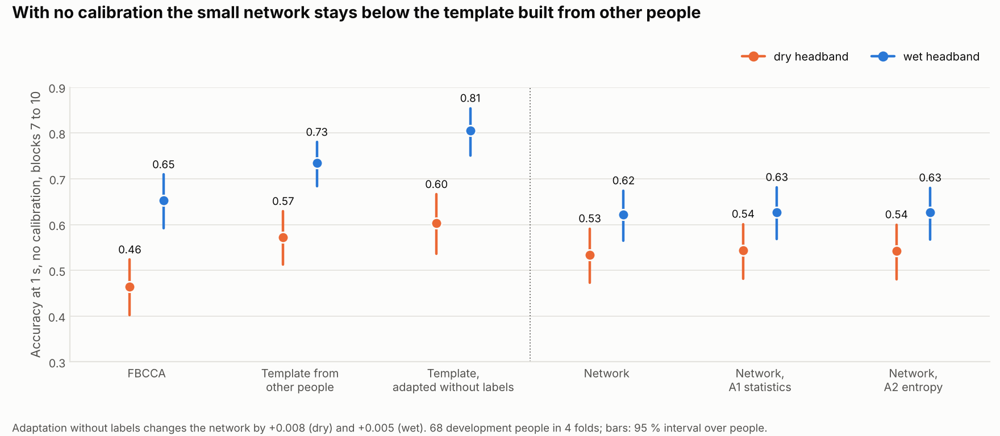
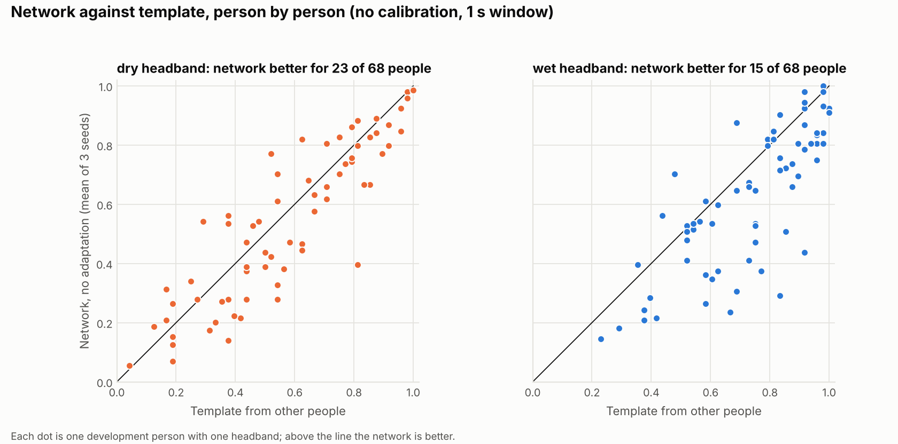

# M3: a small network, and adaptation to a new user without labels

*13 Nov 2026. Plan: [`M3_plan.md`](M3_plan.md), approved by the author before anything was run. Only the 68
development people were loaded; the 34 lockbox people were not. Every person is decoded as a new user with
**no calibration**, 1 s window, blocks 7 to 10. Descriptive statistics with 95 % bootstrap intervals over
people; **no p-value**: the tests of H3 are reserved for the lockbox. Every number below is recomputed by
`scripts/m3_summary.py` (`logs/m3_summary.log`).*

## Result in short

1. **The small network does not beat the template built from other people.** Network 0.53 (dry) and 0.62
   (wet); template 0.57 and 0.73. The network is 0.04 lower with the dry headband (interval -0.07 to -0.01)
   and 0.11 lower with the wet one (-0.15 to -0.08). It is above FBCCA with the dry headband (+0.07) and not
   with the wet one (-0.03, interval -0.08 to +0.01).
2. **Adapting the network without labels helps very little** (H3, development people): +0.008 with the dry
   headband (interval +0.002 to +0.015) and +0.005 with the wet one (-0.001 to +0.011). All of it comes from
   re-estimating the batch-normalisation statistics; the entropy step adds nothing (-0.001). "More for dry
   electrodes" is not supported: +0.003 (-0.005 to +0.012).
3. **Unlabelled data help the template far more.** Updating the template with the user's own unlabelled
   trials, using its own decisions as labels, gives 0.60 (dry) and 0.81 (wet): +0.03 (interval +0.01 to
   +0.05) and +0.07 (+0.05 to +0.10). This is about what one to two **labelled** calibration blocks gave in
   M2 (0.59 and 0.80 with one block, 0.61 and 0.82 with two), without asking the user for anything.
4. **Size and compute:** the network stores 3 652 numbers and decides in 0.9 ms; the template stores 72 000
   and decides in 5.4 ms; the preprocessing (6.1 ms) costs more than any decoder. All are far below the 1 s
   of signal a decision needs.
5. **Limits to keep in mind:** one small architecture, 43 training people, and 11 of the 24 trainings were
   ended by the limit of 60 epochs fixed in the plan, so the network may be somewhat under-trained.

## 1. What was run

- **Folds of people:** 4 folds of 17 test people; each network is trained on 43 people, validated on 8 (early
  stopping) and never sees its 17 test people. 2 headbands x 4 folds x 3 seeds = 24 networks.
- **Network:** EEGNet-type, 3 572 parameters, input = the three sub-bands of the frozen pipeline B2 at 1 s.
- **Same folds for the other methods:** the template uses the 51 training and validation people as its
  population. With 51 people it gives 0.572 (dry) and 0.734 (wet); with 67 (M2) it gave 0.568 and 0.730. The
  size of the population does not matter in this range. FBCCA is identical to M2, trial for trial.
- **Adaptation without labels** on the user's blocks 1 to 6 (72 trials), then test on blocks 7 to 10.

## 2. All methods, same people and trials

| Method | What it needs | Dry | Wet |
|---|---|---|---|
| FBCCA | nothing | 0.465 [0.402, 0.523] | 0.652 [0.592, 0.709] |
| Cross-subject template | other people's data | 0.572 [0.513, 0.629] | 0.734 [0.683, 0.780] |
| Template adapted without labels | + 288 s of the user's signals, no labels | **0.603** [0.537, 0.666] | **0.805** [0.751, 0.854] |
| Network, no adaptation (A0) | other people's data | 0.534 [0.473, 0.591] | 0.621 [0.564, 0.674] |
| Network, A1 statistics | + 288 s, no labels | 0.543 [0.482, 0.601] | 0.627 [0.568, 0.682] |
| Network, A2 entropy | + 288 s, no labels | 0.542 [0.480, 0.600] | 0.626 [0.567, 0.680] |
| Network, online | adapts on the test blocks themselves | 0.539 [0.477, 0.597] | 0.628 [0.571, 0.683] |

## 3. Network against template

| Difference (same people and trials) | Dry | Better / equal / worse | Wet | Better / equal / worse |
|---|---|---|---|---|
| Template minus FBCCA | +0.107 [+0.081, +0.132] | 57 / 6 / 5 | +0.082 [+0.056, +0.108] | 52 / 4 / 12 |
| Network minus FBCCA | +0.069 [+0.028, +0.109] | 44 / 1 / 23 | -0.031 [-0.076, +0.012] | 28 / 0 / 40 |
| Network minus template | -0.038 [-0.067, -0.009] | 23 / 1 / 44 | -0.113 [-0.149, -0.080] | 15 / 1 / 52 |

- The template wins for two people in three with the dry headband and three in four with the wet one.
- A possible reason, not tested: the template decoder is given the structure of the problem (sine-cosine
  references, the mean response of other people); the network has to learn it from 5 160 trials.
- People not above chance with the dry headband: FBCCA 7, template 2, network 5 (of 68).

## 4. Adaptation without labels (H3 on the development people)

| | Dry | Wet |
|---|---|---|
| A1 (statistics) minus A0 | +0.009 [+0.003, +0.016] | +0.006 [-0.001, +0.012] |
| **A2 (entropy) minus A0: `g`** | **+0.008** [+0.002, +0.015] | **+0.005** [-0.001, +0.011] |
| A2 minus A1 | -0.001 [-0.003, +0.001] | -0.001 [-0.002, +0.001] |
| Online minus A0 | +0.005 [-0.000, +0.011] | +0.007 [+0.002, +0.012] |
| People with `g` above 0 / below 0 | 35 / 29 | 36 / 27 |
| Largest loss and gain of one person | -0.049, +0.118 | -0.049, +0.083 |

- **H3a (dry):** a gain of 0.008, whose interval stays above zero. **H3b (wet):** 0.005, interval reaching
  zero. **H3c (more for dry):** `g(dry) - g(wet)` = +0.003 [-0.005, +0.012]. The effect, if any, is below one
  trial in 48. The tests are run on the lockbox as fixed in the plan; these numbers say what to expect.
- The gain is in the people the network decodes poorly: +0.015 [+0.006, +0.023] in the lower half of
  unadapted accuracy with the dry headband, +0.002 in the upper half.
- With six steps at a learning rate of 0.001 (fixed in the plan) the entropy step hardly moves the network.
  Whether a stronger setting would help is a new question, not answered here.

## 5. Unlabelled data and the template

The same 72 unlabelled trials, used in the simplest way: the template decides each of them, the trials
decided as target `f` are averaged into `J_f`, and `T_f = (n0 * P_f + m_f * J_f) / (n0 + m_f)` with `n0` = 4.

- Template adapted minus template: **+0.031** [+0.012, +0.050] (dry; better for 44 people, worse for 18) and
  **+0.071** [+0.048, +0.095] (wet; 54 and 7).
- The decisions used as labels are right for 59 % (dry) and 74 % (wet) of the unlabelled trials. The update
  helps although four in ten of them are wrong with the dry headband.
- Against the adapted network (A2): the adapted template is 0.06 (dry) and 0.18 (wet) higher.
- Next to the labelled calibration of M2 (same test trials): one labelled block 0.593 / 0.797, two 0.607 /
  0.815, six 0.653 / 0.844. Six **unlabelled** blocks give 0.603 / 0.805.

## 6. Seeds and training

- Mean accuracy over people changes by 0.002 to 0.004 (standard deviation) between the three seeds. For one
  person the standard deviation between seeds is 0.028 on average, which is why seeds are averaged.
- Training: 5 160 trials per network, 248 s on average on one core. Validation accuracy 0.64 (dry) and 0.68
  (wet). **11 of the 24 trainings ran to the limit of 60 epochs** (all 12 dry ones ran 57 to 60 epochs), and
  in 9 the best epoch was among the last three: the validation loss was still going down slowly. The limit
  was fixed in the plan and was not changed.

## 7. Size and compute (one decision at 1 s, one core)

| Step | Milliseconds | Stored numbers | Needs |
|---|---|---|---|
| Preprocessing B2 (mains removal, 3 sub-bands) | 6.1 | 0 | nothing |
| FBCCA | 0.25 | 0 | nothing |
| Cross-subject template | 5.4 | 72 000 | other people's data |
| Ensemble TRCA | 0.92 | 72 288 | labelled blocks of the user |
| Network | 0.87 | 3 652 | other people's data |

The template decoder recomputes the spatial filters of the template at every decision; storing them would
shorten its time. The mains removal searches the frequency on a grid at every decision and dominates the
preprocessing.

## 8. Expectations written in the plan, and what came out

| Written before running | Outcome on the development people |
|---|---|
| The network may not beat the template at 1 s | It does not: -0.04 (dry), -0.11 (wet) |
| The gain of adaptation is small (0.01 to 0.04) | Smaller: 0.008 (dry), 0.005 (wet) |
| The gain is larger with the dry headband | Not shown: +0.003 [-0.005, +0.012] |

## 9. Limits

- One architecture and one training recipe, fixed in advance; 11 trainings ended by the epoch limit. A larger
  or longer-trained network could do better. The result is "this small network, trained this way, on 43
  people", not "networks".
- Development people only. The lockbox will give the verdict on H3.
- Every adaptation batch is one block, so it holds one trial of each target. Real use is not balanced like this.
- The six unlabelled blocks come before the test blocks, as in real use; the online variant, which adapts on
  the test blocks themselves, gives the same picture.
- 1 s window only.

## 10. What M3 changes for the next milestones

Proposals; each needs the author's approval.

1. **The practical recipe of the project so far** is not the network. It is: pipeline B2, a template from
   other people, and its update with the user's own unlabelled signals (0.60 dry and 0.81 wet at 1 s with no
   action from the user). The update was a secondary analysis here; if it is to carry a claim, its test on
   the lockbox must be fixed in a plan before the lockbox is opened.
2. **H3 as written** (entropy minimisation on the network) is likely to give a null or tiny result on the
   lockbox. It stays in the family of tests as fixed; a null result will be reported as such.
3. **The network** could be given a longer training in a new, pre-declared run if the author wants a fairer
   test of it. This is optional and would be an addition, not a replacement of these results.
4. **Next: M4** (time on task, impedance, who fails and why; H5), then the single opening of the lockbox.

## 11. Deviations from the M3 plan

| | Deviation | Why |
|---|---|---|
| D1 | Each adaptation batch is one block in the stored order, not a random order of trials. | The files keep no order inside a block, and a block is exactly one batch (12 trials, one per target), so the order inside it has no effect. |
| D2 | Early stopping watches the validation loss. | The plan said "not improved" without naming the quantity. |
| D3 | Online variant: after each block the statistics are re-estimated from all the user's trials so far, then one entropy step is taken. | The plan gave the principle only. |
| D4 | The training (about 50 minutes) was run once. The evaluation was run twice from the saved networks and gave identical files. | Time. Repeatability of the training with a fixed seed is checked by a unit test on synthetic data; the 24 trained networks are stored in `results/m3/models` (0.7 MB). |
| D5 | The time of the template decoder includes recomputing the spatial filters of the template. | Kept as implemented; noted in section 7. |

Nothing else differs from the plan. No lockbox person was loaded. No p-value was computed.

## 12. Files

- Code: `src/ssvep/network.py`, `adapt.py`; tests in `tests/test_m3.py` (synthetic data).
- Scripts: `scripts/m3_common.py`, `m3_train.py`, `m3_evaluate.py`, `m3_compute.py`, `m3_summary.py`, `m3_figures.py`.
- Tables: `results/m3/` (`new_user_accuracy.csv` with every seed, `per_person.csv`, `summary.csv`,
  `differences.csv`, `adaptation_gain.csv`, `training_log.csv`, `compute.csv`, `models/`).
- Figures: `figures/m3/01`, `02`. Logs: `logs/m3_*.log`.
