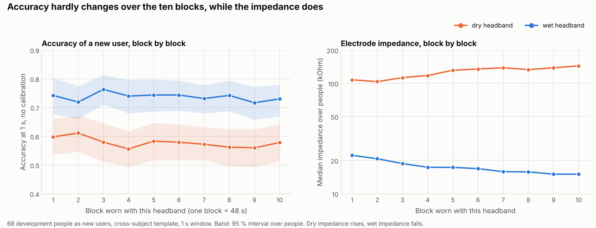
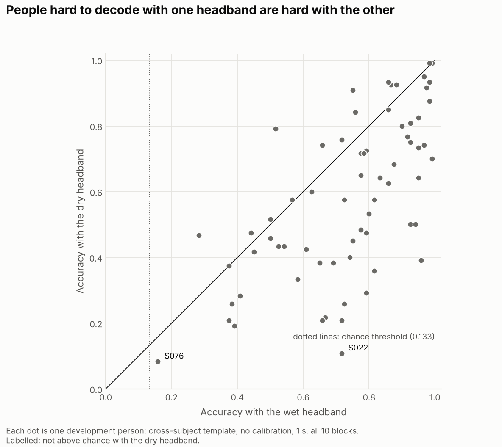
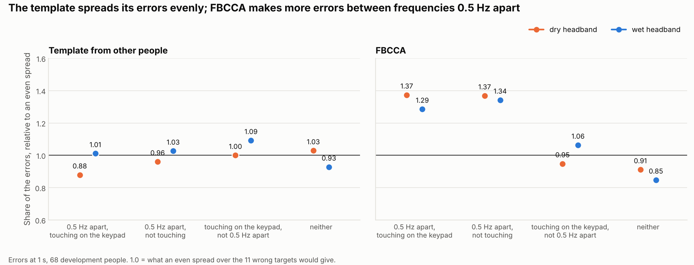

# M4: time on task, impedance, who fails and what is confused

*13 Nov 2026. Plan: [`M4_plan.md`](M4_plan.md), approved by the author before anything was run. Only the 68
development people were loaded; the 34 lockbox people were not. One frozen decoder throughout: the
cross-subject template with **no calibration**, pipeline B2, 1 s window, leave-one-subject-out, all 10 blocks
(120 trials per person and headband). Nothing was trained and no setting was chosen. Descriptive statistics
with 95 % bootstrap intervals over people; **no p-value**: the tests of H5 are reserved for the lockbox. Every
number below is recomputed by `scripts/m4_summary.py` (`logs/m4_summary.log`).*

> **Note added on 14 Nov 2026, after M5.** One saturated trial of one development person (S067, dry headband,
> block 4, target 4) dominates the dry population template for the 9.75 Hz target used in this report. On the
> development people, leaving it out raises the dry accuracy of the template from 0.578 to 0.590. This
> explains why 9.75 Hz is the worst target with dry electrodes in this report. Nothing below was changed. Details: [`M5_realtime.md`](M5_realtime.md), section F.

## Result in short

1. **Accuracy hardly changes over the ten blocks of a headband.** Slope: -0.004 per block with the dry
   headband (interval -0.008 to +0.001) and -0.002 with the wet one (-0.006 to +0.003). Over the whole run
   this is 0.03 and 0.01, and both intervals include zero. Being the **second** headband costs 0.03.
2. **Impedance changes a lot and explains nothing.** Over the ten blocks the dry impedance rises by 37 % and
   the wet one falls by 32 %, yet accuracy does not follow. Across people the correlation between impedance
   and accuracy is +0.07 (dry) and +0.21 (wet), the opposite sign of H5b. Impedance goes with mains pick-up
   (0.68, dry), not with decoding.
3. **Who is hard to decode is mostly a property of the person.** A person's accuracy with the dry headband
   goes with their accuracy with the wet one (Spearman 0.68), and with the single-trial SNR of M0 (0.64 dry,
   0.55 wet); noise floor, mains pick-up and impedance explain little.
4. **Two people are not above chance with the dry headband, none with the wet one** (FBCCA: four and none).
   One of the two decodes well with the wet headband (0.72), which points to the dry contact; the other is
   poor with both.
5. **The template makes no systematic confusion.** Its errors are spread evenly over the wrong targets.
   FBCCA sends 1.3 to 1.4 times too many errors to targets 0.5 Hz away. The keypad of the dataset was built
   so that such targets are never side by side, which allowed the two kinds of confusion to be separated.
6. **H5 on the development people:** neither half is supported. H5a (accuracy falls with time): a small
   negative slope that zero cannot be excluded from. H5b (impedance explains differences between people): no.
   The tests are run on the lockbox as fixed.

## A. Time on task

| Block | 1 | 2 | 3 | 4 | 5 | 6 | 7 | 8 | 9 | 10 |
|---|---|---|---|---|---|---|---|---|---|---|
| Dry | 0.598 | 0.612 | 0.580 | 0.556 | 0.583 | 0.580 | 0.572 | 0.562 | 0.560 | 0.578 |
| Wet | 0.743 | 0.719 | 0.763 | 0.740 | 0.744 | 0.744 | 0.732 | 0.743 | 0.717 | 0.730 |

| Slope per block, mean over people [95 % interval] | Dry | Wet |
|---|---|---|
| Accuracy (**H5a**) | -0.0035 [-0.0078, +0.0008] | -0.0016 [-0.0062, +0.0027] |
| People with a negative / positive slope | 36 / 31 | 36 / 32 |
| Single-trial SNR at Oz (dB) | -0.021 [-0.068, +0.031] | -0.037 [-0.086, +0.015] |
| log10 of the impedance | +0.0153 [+0.0103, +0.0201] | -0.0185 [-0.0210, -0.0159] |

- First five blocks against last five: 0.586 then 0.571 (dry, difference -0.015 [-0.038, +0.009]); 0.742 then
  0.733 (wet, -0.009 [-0.035, +0.017]).
- **The session as worn.** People who wore the dry headband first: 0.580 (dry) then 0.711 (wet). People who
  wore the wet one first: 0.766 (wet) then 0.576 (dry). The crossover estimate of being the second headband
  is -0.030. So the clearest effect of time is between the two halves of the session, not inside a headband.
- **Ageing of a calibration.** A template made of the person's blocks 1 and 2 loses -0.003 per block over
  blocks 3 to 10 with either headband, no faster than the template without calibration (difference of the
  slopes: -0.0025 [-0.0078, +0.0020] dry, +0.0015 [-0.0018, +0.0049] wet). Within the roughly eight minutes of
  a headband, a calibration does not go stale.
- Limit: one block is 12 trials, so a person's block accuracy moves in steps of 0.08; a run of ten blocks
  lasts about eight minutes. Effects that need hours cannot show here.

## B. Impedance

- Median over people: 125 kOhm with the dry headband (19 to 1368) and 17 kOhm with the wet one (1 to 68).

| Spearman correlation across people [95 % interval] | Dry | Wet |
|---|---|---|
| Impedance and accuracy (**H5b** expects a negative value) | +0.07 [-0.19, +0.32] | +0.21 [-0.05, +0.43] |
| Impedance and single-trial SNR | +0.10 [-0.15, +0.32] | +0.08 [-0.17, +0.32] |
| Impedance and noise floor | +0.19 [-0.05, +0.41] | +0.01 [-0.23, +0.24] |
| Impedance and mains pick-up | +0.68 [+0.51, +0.81] | +0.13 [-0.12, +0.37] |

- Within a person, the impedance of a block does not go with the accuracy of that block: mean correlation
  -0.06 [-0.14, +0.03] (dry) and +0.01 [-0.07, +0.10] (wet).
- Reading: with this amplifier a high impedance lets in more mains interference, which the pipeline removes.
  It does not make the response smaller. Impedance is therefore a poor predictor of who will be decodable.

## C. Who fails

Not above chance over 120 trials (below 0.133): **2 people with the dry headband, none with the wet one**.
With FBCCA: 4 and none. Below 0.30: 11 (dry), 2 (wet), 1 with both.

| Person | Fails with | 1 s | Other headband, 1 s | Same headband, 2 s | Ensemble TRCA, 1 s | SNR (dB) | Mains (µV) | Impedance (kOhm) | Worn |
|---|---|---|---|---|---|---|---|---|---|
| S022 | dry | 0.108 | 0.717 | 0.233 | 0.100 | -0.66 | 28 | 122 | first |
| S076 | dry | 0.083 | 0.158 | 0.167 | 0.117 | -0.94 | 16 | 157 | second |

- S022 decodes well with the wet headband: the dry contact failed for this person, not the response.
  Calibration (ensemble TRCA) and a longer window do not rescue it.
- S076 is close to chance with both headbands: the response itself is weak.
- Their impedance and mains pick-up are ordinary (medians of the others: 124 kOhm, 63 µV). What sets them
  apart is the SNR: -0.80 dB against 3.70 dB for the others.

| Spearman correlation of accuracy across people [95 % interval] | Dry | Wet |
|---|---|---|
| with single-trial SNR at Oz (M0, no decoder) | +0.64 [+0.46, +0.77] | +0.55 [+0.34, +0.70] |
| with noise floor | -0.15 [-0.39, +0.11] | -0.11 [-0.38, +0.18] |
| with mains pick-up | +0.18 [-0.09, +0.41] | -0.03 [-0.26, +0.21] |
| with impedance | +0.07 [-0.19, +0.32] | +0.21 [-0.05, +0.43] |
| dry accuracy with wet accuracy of the same person | +0.68 [+0.51, +0.79] | |

A two-second look at a spectrum (the SNR of M0) says more about who will be decodable than the impedance
check that is usually done before a recording.

## D. What is confused

The keypad has 3 rows of 4 targets (Figure 1 of the dataset paper), and its frequencies were placed so that
targets side by side or one above the other are never 0.5 Hz apart. A confusion in frequency and a confusion
in space can therefore be told apart.

| Share of the errors | 0.5 Hz apart, touching (diagonal) | 0.5 Hz apart, not touching | Touching, not 0.5 Hz apart | Neither |
|---|---|---|---|---|
| Even spread | 0.091 | 0.076 | 0.348 | 0.485 |
| Template, dry (3 442 errors) | 0.080 | 0.073 | 0.348 | 0.499 |
| Template, wet (2 142 errors) | 0.092 | 0.078 | 0.380 | 0.450 |
| FBCCA, dry (4 282 errors) | 0.125 | 0.104 | 0.330 | 0.442 |
| FBCCA, wet (2 791 errors) | 0.117 | 0.102 | 0.370 | 0.411 |

- **Template:** an error goes to a frequency neighbour 0.92 (dry) and 1.02 (wet) times as often as to an
  average wrong target. No confusion in frequency.
- **FBCCA:** 1.3 to 1.4 times too often to a frequency neighbour, whether it touches on the keypad or not.
  The template knows the phase of each target, which separates neighbours in frequency (their phases differ
  by a quarter of a cycle); the sine-cosine references of FBCCA do not.
- **Space:** errors to a touching target are at the even-spread level with the dry headband (1.00) and
  slightly above with the wet one (1.09). There is little sign that people looked at the wrong key.
- **Targets:** with the dry headband accuracy goes from 0.35 (9.75 Hz) to 0.69 (11.25 Hz); with the wet one
  from 0.63 (13.25 Hz) to 0.79 (10.75 Hz). The decisions are not spread evenly either (dry: 0.053 for 9.75 Hz
  to 0.109 for 11.25 Hz; 0.083 without bias). Why 9.75 Hz is so poor with the dry headband was not examined.

## Expectations written in the plan, and what came out

| Written before running | Outcome on the development people |
|---|---|
| Accuracy falls a little with the dry headband and not with the wet one | A small fall with both; zero cannot be excluded for either |
| Impedance explains little with the dry headband | Confirmed: +0.07 |
| Most people who fail with the dry headband do not fail with the wet one | Two people fail; one is fine with the wet headband, one is poor with both |
| Errors go to keypad neighbours 0.5 Hz away more often than an even spread | Wrong premise (see D1). The template shows no excess; FBCCA shows an excess to frequency neighbours wherever they are |

## What M4 changes for the next step

1. **H5 is likely to give two null results on the lockbox.** They stay in the family of 15 tests and will be
   reported as they come.
2. **For a wearable device,** the useful facts are: accuracy is stable over eight minutes with either
   headband; a calibration does not go stale in that time; impedance is not the number to watch, the SNR of a
   short test recording is; and a few percent of people cannot be decoded with dry electrodes whatever the
   method.
3. **Next: the single opening of the lockbox,** by a short plan that lists the frozen methods and the 15 tests.

## Deviations from the M4 plan

| | Deviation | Why |
|---|---|---|
| D1 | The error classes are not those of the plan. The plan assumed a keypad of 4 rows and 3 columns in which targets 0.5 Hz apart are stacked. Figure 1 of the dataset paper shows 3 rows of 4 targets, with frequencies placed so that touching targets (side by side or above each other) are never 0.5 Hz apart. Classes used: frequency neighbour or not, crossed with touching on the keypad or not (diagonals included). | The plan said the layout had to be checked against the figure. The classes were fixed in the code and its unit test before any decision was looked at (commit "M4 code before the data"). |
| D2 | The session as a whole is given as the mean accuracy with the first and the second headband by order of wearing, not as a curve over 20 blocks. | The two halves use different electrodes, so a single curve would mix time with electrode type. |
| D3 | Part C lists all failures in one table; ensemble TRCA comes from the leave-one-block-out baselines of M2. | As planned; stated for clarity. |

Nothing else differs from the plan. No lockbox person was loaded. No p-value was computed.

## Files

- Code: `src/ssvep/keypad.py`, additions to `stats.py` (slope over blocks, permutation test); tests in
  `tests/test_m4.py`.
- Scripts: `scripts/m4_decode.py`, `m4_summary.py`, `m4_figures.py`.
- Tables: `results/m4/` (`decisions_1s.csv` with the decision of every trial, `accuracy_by_block.csv`,
  `slopes.csv`, `ageing_1s.csv`, `impedance_blocks.csv`, `people.csv`, `failures.csv`, `accuracy_2s.csv`,
  `error_classes.csv`).
- Figures: `figures/m4/01` to `03`. Logs: `logs/m4_*.log`.
