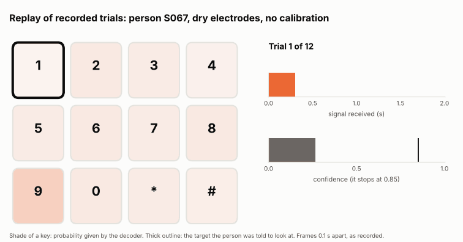
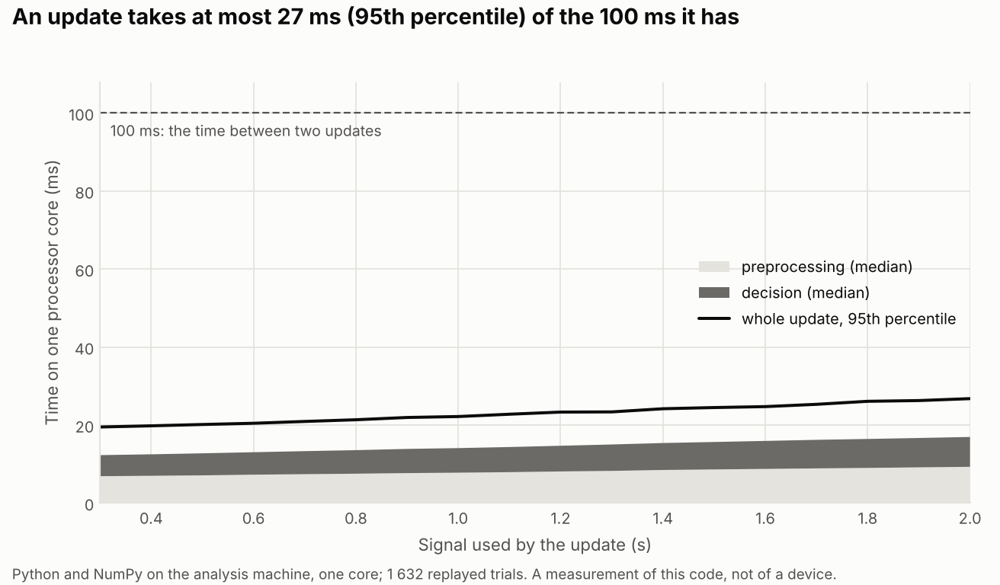
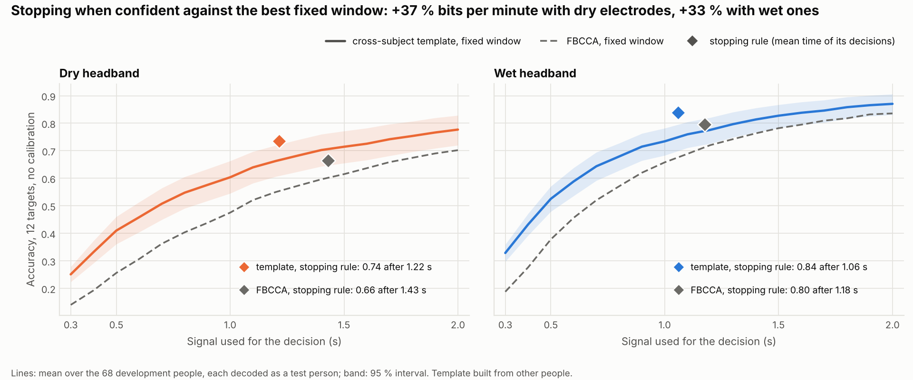
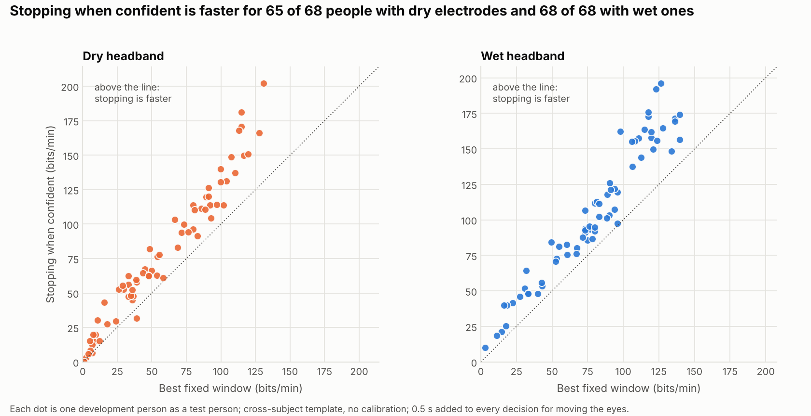
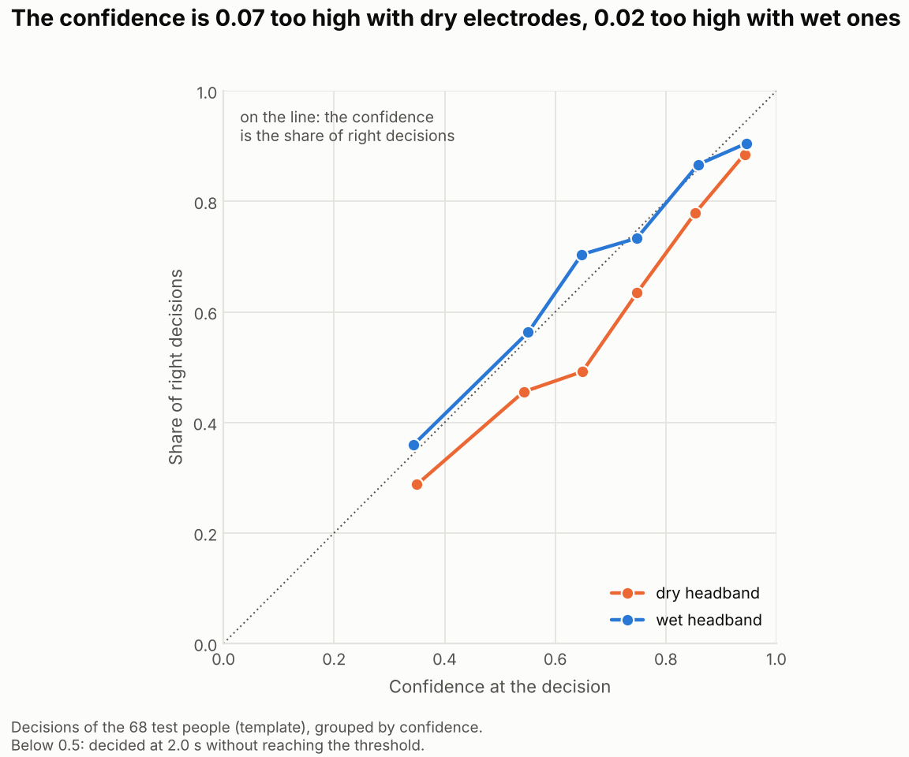

# M5: the decoder on a stream, its latency, and stopping when confident

*14 Nov 2026. Plan: [`M5_plan.md`](M5_plan.md), approved by the author with its three defaults before anything
was run. **Development people only (68), no test and no p-value; the lockbox stays opened once.** Folds of M3:
in each fold 43 people build the template, 8 validation people set the choices, 17 test people are decoded.
Every number is in `logs/m5_stopping.log`, `logs/m5_stream.log` or `logs/m5_template_check.log`.*

## Result in short

1. **Fed by a stream, the decoder gives exactly the numbers of the fixed-window code.** 1 632 trials were
   replayed in pieces of 0.1 s: all 29 376 updates have the same scores as the code of M2 (largest
   difference 0), and no update uses a sample that had not arrived.
2. **One update takes 15 ms** (median; 95th percentile 23 ms, largest 55 ms) on one processor core, for the
   100 ms between two updates. None of the 29 376 updates was late.
3. **Stopping when confident is about a third faster than the best fixed window.** With the cross-subject
   template and no calibration: 79.4 against 58.1 bits/min with dry electrodes (+21.3 [+17.7, +24.7], +37 %)
   and 104.9 against 79.0 with wet ones (+25.8 [+22.3, +29.4], +33 %). It is faster for 65 of 68 people (dry)
   and 68 of 68 (wet). FBCCA gains as much (+31 % and +30 %).
4. **At the same time per decision it is more accurate:** +0.053 [+0.039, +0.069] (dry) and
   +0.078 [+0.060, +0.098] (wet) against a fixed window at least as long as its mean decision time.
5. **The confidence cannot be fully believed.** It is 0.07 too high on average with dry electrodes and 0.02
   with wet ones, and far too high for the people who are hard to decode (+0.21 dry, +0.12 wet for the hardest
   third). The decisions forced at 2.0 s (22 % dry, 16 % wet) are right 41 % and 54 % of the time.
6. **A flaw was found on the way, in the earlier milestones.** One trial that reaches the limit of the
   converter (S067, dry, flagged in M0) dominates the dry population template for the 9.75 Hz target in M2,
   M3, M4 and in the final evaluation. On the development people, removing that one trial raises the dry
   accuracy from 0.578 to 0.590, and at 9.75 Hz from 0.35 to 0.53. Section F.

## A. The stream against the fixed-window code

`stream.StreamDecoder` receives pieces of 25 samples. It is told where the response starts, and from 0.3 s to
2.0 s it updates every 0.1 s with the samples received so far.

| Headband | Trials | Updates | Largest difference of a score | Same decision |
|---|---|---|---|---|
| Dry | 816 | 14 688 | 0 | 14 688 of 14 688 |
| Wet | 816 | 14 688 | 0 | 14 688 of 14 688 |

The first block of every development person, with the template of the fold in which the person is a test
person. Unit tests on synthetic signals check the same thing, and that changing samples that have not arrived
changes nothing.

As a second check, FBCCA with a fixed window of 1.0 s gives 0.475 (dry) and 0.658 (wet) here, the values of M2.

## B. Latency

| Signal used | Preprocessing (median) | Decision (median) | Whole update, median | 95th percentile | Largest |
|---|---|---|---|---|---|
| 0.3 s | 6.9 ms | 5.4 ms | 12.3 ms | 19.5 ms | 27.9 ms |
| 1.0 s | 7.8 ms | 6.3 ms | 14.1 ms | 22.2 ms | 33.3 ms |
| 2.0 s | 9.3 ms | 7.7 ms | 17.0 ms | 26.8 ms | 40.4 ms |

- All updates: median 15.3 ms, 95th percentile 23.4 ms, largest 55.0 ms. Real-time factor at the 95th
  percentile: 0.20 to 0.27.
- A whole trial costs 272 ms of processor time (median) for 2 s of signal.
- The latency of a decision is the signal it used plus one update: a decision taken on 1.0 s of signal is
  available about 15 ms later.
- This is Python and NumPy on one core of the analysis machine (x86-64), with every update recomputed from
  the start of the trial. It is a measurement of this code, not of a device.

## C. Stopping when confident

The scores of an update are turned into probabilities, `p_f = exp(b_T s_f) / sum_g exp(b_T s_g)`, with one
`b_T` per length of signal fitted on the validation people. The decoder decides at the first update where the
largest probability reaches `theta`, and at 2.0 s in any case. `theta` and, for comparison, the best fixed
window were both chosen on the validation people by the highest mean ITR
(`60 / (T_mean + 0.5) * bits`, with 0.5 s for moving the eyes).

**Test people, mean [95 % interval over the 68 people]:**

| Decoder | Headband | ITR, stopping rule | ITR, best fixed window | Difference | Faster with stopping |
|---|---|---|---|---|---|
| Template | dry | 79.4 [67.7, 90.8] | 58.1 [49.2, 66.9] | +21.3 [+17.7, +24.7] | 65 of 68 |
| Template | wet | 104.9 [93.3, 115.9] | 79.0 [70.0, 87.5] | +25.8 [+22.3, +29.4] | 68 of 68 |
| FBCCA | dry | 60.4 [49.5, 71.0] | 46.2 [39.0, 53.5] | +14.2 [+10.4, +18.0] | 60 of 68 |
| FBCCA | wet | 88.3 [76.9, 99.3] | 67.9 [58.8, 76.7] | +20.5 [+17.6, +23.4] | 67 of 68 |

| Decoder | Headband | Accuracy, stopping | Mean time | Accuracy, best fixed window | Its length (by fold) |
|---|---|---|---|---|---|
| Template | dry | 0.736 | 1.22 s | 0.635 | 0.9 to 1.4 s |
| Template | wet | 0.838 | 1.06 s | 0.746 | 0.9 to 1.2 s |
| FBCCA | dry | 0.664 | 1.43 s | 0.641 | 1.6 to 1.7 s |
| FBCCA | wet | 0.795 | 1.18 s | 0.705 | 1.0 to 1.2 s |

- **Chosen on the validation people:** `theta` = 0.80 or 0.85 (template, dry), 0.80 to 0.90 (template, wet).
- **At the same time:** the template with the stopping rule reaches 0.736 after 1.22 s on average (dry); a
  fixed window of 1.3 s reaches 0.683. With wet electrodes: 0.838 after 1.06 s against 0.760 at 1.1 s.
- **When it decides** (template): 9 % of the dry decisions by 0.5 s, 38 % between 0.6 and 1.0 s, 31 %
  between 1.1 and 1.9 s, and 22 % at 2.0 s without having reached `theta`. Wet: 17 %, 44 %, 23 %, 16 %.
- **The decisions it takes by itself are good; the forced ones are not.** Before 2.0 s: 0.83 right (dry), 0.90
  (wet). Forced at 2.0 s: 0.41 and 0.54. A device could refuse to decide in that case and ask for another look.

Three people are not faster with the rule, all with dry electrodes (S044, S061, S076); two of them are among
the hardest to decode (accuracy 0.28 and 0.12). The gain grows with the person's accuracy (Spearman 0.67 dry, 0.60 wet).

## D. Can the confidence be believed?

| | Mean confidence | Accuracy | Hardest third of the people | Easiest third |
|---|---|---|---|---|
| Template, dry | 0.805 | 0.736 | confidence 0.21 too high (accuracy 0.48) | 0.05 too low (accuracy 0.94) |
| Template, wet | 0.860 | 0.838 | 0.12 too high (accuracy 0.66) | 0.05 too low (accuracy 0.97) |

One `b_T` for everybody is right on average and wrong for each person: the people who are hard to decode get
a confidence that is too high, the easy ones one that is too low (Spearman of the gap with accuracy: -0.94
dry, -0.79 wet). The rule therefore stops too early for the people it serves worst. A scale adapted to the
person, from the unlabelled trials already used in H6, is the obvious next step; it was not tried here.

## E. Expected before running, and found

| Expected | Found |
|---|---|
| The stopping rule gives a higher ITR than the best fixed window, for both headbands | Yes: +37 % (dry), +33 % (wet) |
| The gain is larger with wet electrodes | In bits/min yes (+25.8 against +21.3); relative to the fixed window no |
| The confidence is too high for the people who are hard to decode | Yes, by 0.21 (dry) and 0.12 (wet) |
| One update takes well under 0.1 s | Yes: 15 ms (median), 23 ms (95th percentile) |

## F. A flaw found on the way: one saturated trial in the population template

**How it was found.** With a fixed window of 1.0 s the template gave 0.604 with dry electrodes here, and 0.578
in M4 for the same people. FBCCA agreed exactly, so the difference had to come from the template. The mean
response of one person, S067 with the dry headband, is about 50 times larger than anybody else's.

**What it is.** M0 flagged one trial in the whole dataset that reaches the limit of the converter: S067, dry,
block 4, target 4. After preprocessing its size is 2 900, against 10.5 for the person's other trials of that
target. The population template is a plain mean over people, so this one trial makes the dry entry of
target 4 (9.75 Hz) about 4 times larger than the other entries and mostly artefact. In the folds of M5, S067
happens to be a validation or a test person in every fold, never one of the 43, which is why M5 is not
affected and why the difference appeared.

**What it cost** (`scripts/m5_template_check.py`; development people, frozen decoder, 1 s, no calibration, ten
blocks, leave-one-subject-out as in M4; "repaired" leaves that one trial out and changes nothing else):

| | Frozen (M2 to M4) | Repaired | Difference |
|---|---|---|---|
| Dry, all targets | 0.578 | 0.590 | +0.011 [+0.007, +0.016]; 45 people better, 9 worse |
| Dry, target 4 (9.75 Hz) | 0.347 | 0.529 | |
| Wet, all targets | 0.737 | 0.737 | 0 |

The frozen variant reproduces the 136 accuracies of M4 exactly. This explains what M4 left open: 9.75 Hz was
the worst target with dry electrodes (0.35) because its template entry was spoiled.

**What it means for earlier results.**

- M2, M3, M4 and the final evaluation used the dry template with this trial in it. Their dry numbers for the
  template are therefore slightly too low (about 0.01 on the development people).
- In the final evaluation the tests that use the dry template are H2 (dry), H5 (dry) and H6 (dry). H1, H3 and
  everything with wet electrodes do not use it. Part of the gain of H6 with dry electrodes may come from
  the adaptation repairing that entry; this is not known.
- **Nothing was re-run on the lockbox people.** The plan of the final evaluation says that if an error is
  found afterwards, the original and the corrected result are both reported. Doing so means decoding the
  lockbox people a second time, with a correction decided after their results were seen. That is the
  author's decision; until then the tested results stand as the results of the frozen method.

  > **Added later on 14 Nov 2026.** The author approved a correction plan, and the corrected analysis was run
  > once: [`final_correction.md`](final_correction.md). No decision changes; the same seven tests are supported.
  > The suspicion about H6 above was not borne out: on the lockbox people its estimate goes from +0.040 to
  > +0.045.

- The numbers of M5 with the dry template (for example 0.604 at 1.0 s) cannot be compared with those of M2 to
  M4 (0.578): the templates differ.

**The lesson for the method:** a template averaged over people needs protection against one recording that
is much larger than the others (leaving out saturated trials, or a mean that limits each person's weight).

## G. The animation

`figures/m5/replay.gif` replays the first block of one person at the speed of the recording (frames 0.1 s
apart; a pause after each decision). The person was fixed by the plan, not chosen by looking: the one with the
median accuracy among the test people of the first fold, dry headband. That person is S067, the same as in
section F; the replayed block is block 1, not the block with the saturated trial. 11 of 12 decisions are
right, after 1.85 s on average. The dataset stores the trials of a block sorted by target, so the order shown
is not the order in which they were recorded.

## H. Limits

- A replay of recordings: nobody reacts to the decisions, and nothing is said about a person using the system.
- The decoder is told when the flicker starts. Noticing that the user looks at no target is not studied.
- Trials last 2 s, so the rule cannot wait longer, and a fifth of its decisions are forced.
- Development people, on whom the preprocessing was chosen; no test.
- The times are those of Python code on one machine.

## I. Deviations from the plan

| | Deviation | Why |
|---|---|---|
| D1 | A diagnostic was added: `scripts/m5_template_check.py` (section F). | The dry template accuracy did not match M4, and the cause had to be found. Development people only. |
| D2 | The computation took about 12 minutes, not 30. | Estimate too high. |
| D3 | Lab Streaming Layer is not used (as planned); the stream is an object inside the program. | Stated in the plan. |
| D4 | The slides got one new slide for M5 and a fifth card on the slide of what went wrong, not only changed sentences. The report got section 6, a fifth point in section 8 and the section of recommendations. | The flaw of section F had to be shown. |

Nothing else differs from the plan: no method was changed, no lockbox person was used, no test was run.

## Files

`src/ssvep/stream.py`, `scripts/m5_scores.py`, `m5_stopping.py`, `m5_stream.py`, `m5_template_check.py`,
`m5_figures.py`, `tests/test_m5.py`, `results/m5/` (`settings.csv`, `decisions.csv`, `people.csv`,
`accuracy_by_window.csv`, `reliability.csv`, `latency.csv`, `stream_check.csv`, `template_check.csv`),
`figures/m5/`, `logs/m5_*.log`. `latency.csv` and `logs/m5_stream.log` hold measured times and change from
run to run; all other tables are identical in a second run.
