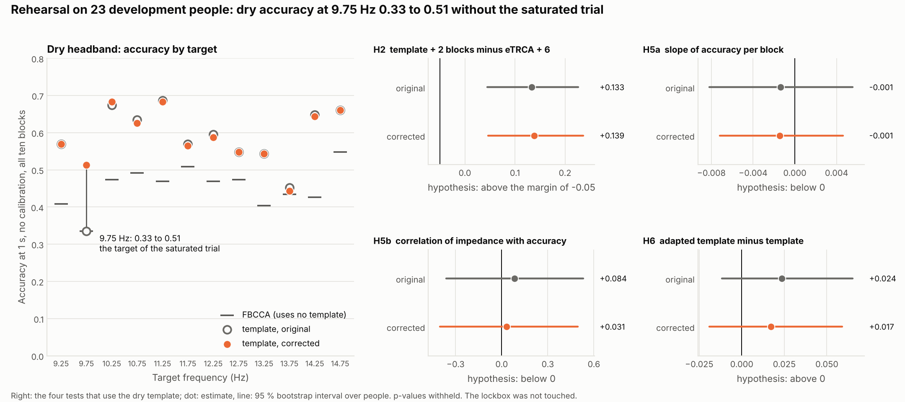
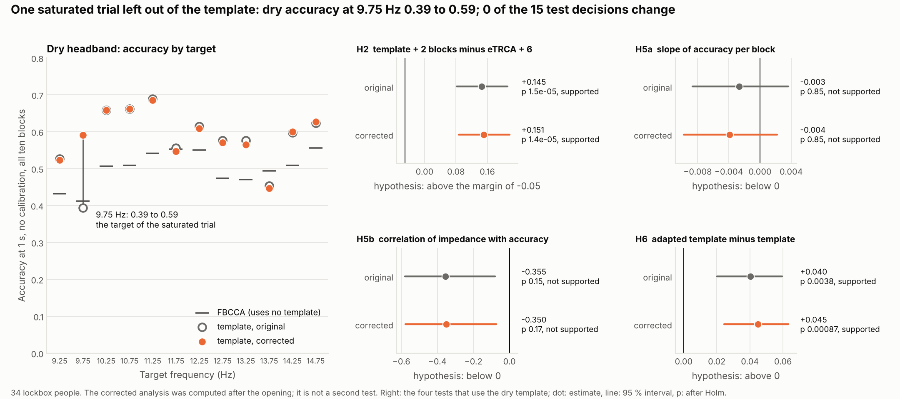

# Correction of the final evaluation: the results with the repaired dry template

*14 Nov 2026. Plan: [`final_correction_plan.md`](final_correction_plan.md), approved by the author on
14 Nov 2026 with its two defaults (Q1: run on the lockbox people once the rehearsal has passed its checks;
Q2: the headline numbers stay those of the opening).*

> **Status: done.** Part A was committed before the corrected run (commit `ab7d7d6`); the run was made once,
> on 14 Nov 2026, from that commit; parts B to D were written after it.

## Result in short

**No decision changes. Seven of the 15 tests are supported in the original analysis and in the corrected
one, and they are the same seven.**

1. **Everything that does not use the dry template came out identical to the opening:** 1 870 accuracies,
   4 080 decisions of the wet template, 8 160 decisions of FBCCA, and the estimate, interval and p-value of
   11 tests.
2. **The four tests that use the dry template keep their outcome:** H2 dry and H6 dry supported, H5a dry and
   H5b dry not supported.
3. **The flaw cost about 0.01 of accuracy with dry electrodes:** the template with no calibration goes from
   0.567 to 0.577 on the lockbox people; at the 9.75 Hz target from 0.39 to 0.59.
4. **The headline numbers of the project stay those of the opening,** which is the pre-specified analysis.
   The corrected numbers were computed after the lockbox results had been seen; they are reported next to the
   original ones and are **not a second test**.

## A. Before the run

### A1. The correction

**Rule:** a trial that M0 flagged as reaching the limit of the converter is not used to build the population
template. The list comes from `results/m0/flagged_trials.csv` (written in M0 from the raw values of all 102
people, before any decoding). It holds one trial: S067, dry headband, block 4, target 4 (9.75 Hz). S067 is a
development person.

Built from the development people only (`logs/final_correction_lockbox_prepare.log`):

| | Size of that trial | The person's 9 other trials of the target (median) |
|---|---|---|
| S067, dry, block 4, target 4 | 2 900 | 10.5 |

| Dry population template | Entry of the 9.75 Hz target, original | Repaired | The 11 other entries (median) |
|---|---|---|---|
| 68 development people (used for the lockbox people) | 4.27 | 0.91 | 1.01 |
| 45 development people (used in the rehearsal) | 6.42 | 0.99 | 1.09 |

- The repaired dry template differs from the original in the entry of that one target and nowhere else.
- The wet template has the same checksum as in the opening. The six networks are the files of the opening.
- The checksums of the repaired template are in `results/final/lockbox_corrected/frozen.json`, committed
  before the run; the run refuses to start if they do not match.

### A2. Code and unit tests

- `scripts/final_correction.py` builds the repaired template and then calls the decoding function of the
  opening (`final_evaluation.evaluate_person`) and its 15 tests. **`final_evaluation.py` and the modules it
  uses are not edited**: they are the files of the commit of the opening.
- The run on the lockbox people needs `--correct-lockbox`, an opening that is complete and a clean commit. It
  is recorded in `results/final/LOCKBOX_CORRECTION.txt` before the first person is decoded and is refused a
  second time.
- 5 new unit tests on synthetic data (`tests/test_correction.py`): the flagged trials come from the M0 file;
  the repaired template differs only where a trial was left out, and is identical bit for bit when nothing is
  left out; the run is made once and after the opening; the built-in check passes when only the dry template
  results move and fails when anything else moves; the rehearsal keeps no p-value. All 82 tests pass.

### A3. Rehearsal on the development people

The split of the first rehearsal: 23 development people as new people, 45 as population (S067 is one of the
45). No p-value is written or shown. `logs/final_correction_rehearsal.log`.

**Check fixed in the plan: what does not use the dry template is identical to the first rehearsal.** Passed.

| | Differ from the first rehearsal |
|---|---|
| Accuracies that do not use the dry template | 0 of 1 265 |
| Decisions of the wet template | 0 of 2 760 |
| Decisions of FBCCA | 0 of 5 520 |
| Impedance file | identical |
| The 11 tests that do not use the dry template (estimate, interval) | 0 of 11 |
| Accuracies that use the dry template | 103 of 161 |
| Decisions of the dry template | 134 of 2 760 |
| The 4 tests that use the dry template (estimate, interval) | 4 of 4 |

**The dry template numbers move, and by little** (23 development people, 1 s):

| Dry headband | Original | Corrected | Difference [95 % interval] |
|---|---|---|---|
| Template, no calibration, blocks 7 to 10 | 0.576 | 0.589 | +0.013 [+0.001, +0.024] |
| Template, no calibration, all ten blocks | 0.576 | 0.589 | +0.012 [+0.006, +0.018] |
| Template + 2 calibration blocks | 0.629 | 0.634 | +0.005 [-0.004, +0.015] |
| Template adapted without labels | 0.600 | 0.606 | +0.006 [-0.004, +0.018] |
| 9.75 Hz target only (all ten blocks) | 0.335 | 0.513 | |

| Estimate (p-values withheld) | Original | Corrected |
|---|---|---|
| H2 dry: template + 2 blocks minus eTRCA + 6 blocks | +0.133 | +0.139 |
| H5a dry: slope of accuracy per block | -0.0014 | -0.0014 |
| H5b dry: correlation of impedance with accuracy | +0.08 | +0.03 |
| H6 dry: adapted template minus template | +0.024 | +0.017 |

- The other 11 targets change by 0.009 at most.
- The gain of the adaptation (H6 dry) becomes smaller, as the plan suspected: part of it was the adaptation
  repairing the spoiled entry. *(Written before the run. On the lockbox people this did not hold: see B4.)*
- The reproduction mode was run on the rehearsal set: the five result files are identical.

## B. The corrected run on the 34 lockbox people

Made once, on 14 Nov 2026, from commit `ab7d7d6` (pushed before the run), in 69 seconds, not interrupted
(`results/final/LOCKBOX_CORRECTION.txt`). Every number below is in `logs/final_correction_lockbox.log`; the
tables are in `results/final/lockbox_corrected/`.

The lockbox people have now been decoded for the opening (13 Nov), for two reproductions of it that gave
identical files (13 Nov, and the fresh-clone check of M6), and for this run. This run is the only one that
is a different analysis.

### B1. Built-in check: passed

| | Differ from the opening |
|---|---|
| Accuracies that do not use the dry template | 0 of 1 870 |
| Decisions of the wet template | 0 of 4 080 |
| Decisions of FBCCA | 0 of 8 160 |
| Impedance file | identical |
| The 11 tests that do not use the dry template (estimate, interval, p-value) | 0 of 11 |
| Accuracies that use the dry template | 150 of 238 |
| Decisions of the dry template | 230 of 4 080 |
| The 4 tests that use the dry template | 4 of 4 |

"Identical" means identical in the result files as written (accuracies with 6 decimals, test results with 6
significant digits).

### B2. The four tests that use the dry template

One-sided tests; Holm correction at a familywise level of 0.05 over all 15 tests, in each analysis.

| Test | | Estimate [95 % interval] | p | p after Holm | Outcome |
|---|---|---|---|---|---|
| **H2 dry** template + 2 blocks minus eTRCA + 6 blocks (margin -0.05) | original | +0.145 [+0.081, +0.211] | 1.1e-06 | 1.5e-05 | supported |
| | corrected | +0.151 [+0.088, +0.216] | 9.5e-07 | 1.4e-05 | supported |
| **H5a dry** slope of accuracy per block | original | -0.0027 [-0.0087, +0.0036] | 0.19 | 0.85 | not supported |
| | corrected | -0.0039 [-0.0098, +0.0022] | 0.14 | 0.85 | not supported |
| **H5b dry** correlation of impedance with accuracy | original | -0.355 [-0.580, -0.079] | 0.019 | 0.15 | not supported |
| | corrected | -0.350 [-0.577, -0.074] | 0.021 | 0.17 | not supported |
| **H6 dry** adapted template minus template | original | +0.040 [+0.020, +0.059] | 0.00043 | 0.0038 | supported |
| | corrected | +0.045 [+0.025, +0.063] | 0.000097 | 0.00087 | supported |

The 11 other tests have the same estimate, interval and p-value in both analyses. Their p-value after Holm
can move, because it depends on the order of all 15: it does for the two ensemble TRCA tests of H1 (1.5e-05
to 1.4e-05) and for no other.

**By the reading rule fixed in the plan** (supported only if supported in both analyses):

| Hypothesis | Original | Corrected | In both |
|---|---|---|---|
| H1 dry below wet | supported, 4 of 4 | supported, 4 of 4 | **supported** |
| H2 template + 2 blocks against eTRCA + 6 blocks | dry supported, wet not | dry supported, wet not | **dry supported, wet not** |
| H3 entropy adaptation of the network | not supported, 0 of 3 | not supported, 0 of 3 | not supported |
| H5a accuracy falls over the session | not supported, 0 of 2 | not supported, 0 of 2 | not supported |
| H5b higher impedance, lower accuracy | not supported, 0 of 2 | not supported, 0 of 2 | not supported |
| H6 template adapted without labels | supported, 2 of 2 | supported, 2 of 2 | **supported** |

### B3. The accuracies that use the dry template

34 lockbox people, 1 s, mean over people; difference with a 95 % interval over people.

| Dry headband | Original | Corrected | Difference | People better / equal / worse |
|---|---|---|---|---|
| Template, no calibration, blocks 7 to 10 | 0.567 | 0.577 | +0.010 [+0.003, +0.017] | 15 / 14 / 5 |
| Template + 1 calibration block | 0.589 | 0.603 | +0.013 [+0.007, +0.021] | 18 / 13 / 3 |
| Template + 2 calibration blocks | 0.621 | 0.626 | +0.006 [-0.001, +0.012] | 10 / 19 / 5 |
| Template + 4 calibration blocks | 0.639 | 0.653 | +0.013 [+0.006, +0.021] | 15 / 15 / 4 |
| Template + 6 calibration blocks | 0.654 | 0.663 | +0.009 [+0.002, +0.017] | 12 / 18 / 4 |
| Template adapted without labels | 0.607 | 0.621 | +0.014 [+0.005, +0.023] | 16 / 14 / 4 |
| Template, no calibration, all ten blocks | 0.577 | 0.590 | +0.013 [+0.007, +0.019] | 23 / 4 / 7 |

- **By target** (all ten blocks, no calibration): 9.75 Hz goes from 0.394 to 0.591. The 11 other targets
  change by 0.012 at most, some slightly down: the spoiled entry no longer loses to them.
- **Share of the dry decisions given to the 9.75 Hz target:** 0.063 before, 0.090 after (0.083 if even).
- **Template minus FBCCA, dry, no calibration:** +0.062 [+0.034, +0.089] before, +0.072 [+0.042, +0.101]
  after. Adapted template minus FBCCA: +0.103 before, +0.117 after.
- **The template's own decisions on blocks 1 to 6** (the labels of the adaptation) are right 58.4 % of the
  time before and 60.0 % after.
- Nobody is below the chance threshold with the dry template, before or after.
- **The same size as on the development people:** there, leaving the trial out raised the dry accuracy over
  the ten blocks by +0.011 [+0.007, +0.016] (M5); here by +0.013 [+0.007, +0.019].

### B4. Expectation written in the plan, and the outcome

| | Expected before the run | Outcome |
|---|---|---|
| Dry accuracy of the template | rises by about 0.01 | +0.010 |
| H2 dry | stays supported | supported |
| H5a dry, H5b dry | stay not supported | not supported |
| H6 dry | uncertain | supported |

**One suspicion of the plan was wrong.** The plan said that part of the gain of the adaptation (H6 dry) might
be the adaptation repairing the spoiled entry, so that the gain would shrink. In the rehearsal it did shrink
(+0.024 to +0.017). On the lockbox people it did not: the adapted template gains as much from the repair as
the template (+0.014 against +0.010), and the estimate of H6 dry goes from +0.040 to +0.045.

## C. Deviations from the plan

| | What | Why |
|---|---|---|
| D1 | A `prepare` stage writes the checksums of the repaired template to `frozen.json`, committed before the run. Not in the plan. | The opening worked this way; it shows that the template was fixed before the lockbox people were decoded. |
| D2 | A figure script (`scripts/final_correction_figures.py`) and one figure were added. Not in the list of outputs. | Written and tried on the rehearsal before the run. |
| D3 | The script has a `--reproduce` mode. It was run on the rehearsal set only (five files identical). **It has not been run on the lockbox people**: the plan says one run. `run_all.sh` contains it, as it contains the reproduction of the opening. | Reproducibility of the repository. Whoever runs `run_all.sh` decodes the lockbox people again and gets a comparison with the committed files. |
| D4 | The report gives a few numbers beyond the plan's list (accuracy by target, template minus FBCCA, share of decisions). | Same result files; descriptive. |
| D5 | **Five rounding slips in earlier documents were corrected.** While the numbers of this report were checked against the result files, five interval bounds turned out to have been rounded twice (from the four decimals of a log to three): H2 dry lower bound +0.081 (read +0.082) and H6 dry upper bound +0.059 (read +0.060) in the final evaluation, and three bounds of the first rehearsal (-0.269, +0.226, -0.008). | The result files and the logs were right; no estimate, p-value or decision is concerned. Corrected in `final_evaluation.md` (noted there as D4), `final_rehearsal.md`, the report, the README, the analysis plan and slide 4. |
| D6 | **A property of the pre-specified tests was found and checked.** An independent recomputation of the p-values from the result files did not give exactly the p-values of the Wilcoxon tests. Cause: differences of accuracies that are equal as fractions are not always equal as floating point numbers, so the code does not see every tie. `scripts/final_ties_check.py` (written after the opening, result files only) recomputes the 7 Wilcoxon tests of H2, H3 and H6 from integer counts. | The p-values move a little (H6 dry: 0.00043 to 0.00034 in the original analysis, 0.000097 to 0.00014 in the corrected one; H3 wet 0.27 to 0.23). **No decision changes in either analysis.** The reported p-values stay those of the pre-specified code. Noted in `final_evaluation.md` as D5. |

Nothing else was done differently. The decoding function, the networks, the people, the 15 tests and the Holm
correction are those of the opening; `final_evaluation.py` and the modules it uses have no change since the
commit of the opening (`6006614`).

## D. What it means for the project

- **Conclusions:** unchanged. The seven supported tests are supported in both analyses.
- **Numbers quoted in the report, the README, the slides and the graphical abstract:** those of the opening,
  as decided in the plan (Q2). Where a number depends on the dry template, the corrected value is in this
  document and, for the four tests, next to the original in [`final_evaluation.md`](final_evaluation.md) and
  in the [report](../../REPORT.md).
- **The lesson stays:** a template that is a plain mean over people is at the mercy of one bad recording. M0
  had flagged the trial; the flag was not used when the template was built.
- **Not done, and not possible here any more:** a template that protects itself (a median or a trimmed mean
  over people) cannot be tested on this dataset, because the lockbox people have been seen.

## Outputs

| | |
|---|---|
| Code | `scripts/final_correction.py`, `scripts/final_correction_figures.py`, `tests/test_correction.py`, `scripts/final_ties_check.py` |
| Results | `results/final/lockbox_corrected/` (`accuracy.csv`, `decisions_1s.csv`, `impedance.csv`, `tests.csv`, `comparison.csv`, `frozen.json`), `results/final/rehearsal_corrected/`, `results/final/LOCKBOX_CORRECTION.txt` |
| Logs | `logs/final_correction_rehearsal_prepare.log`, `logs/final_correction_rehearsal.log`, `logs/final_correction_lockbox_prepare.log`, `logs/final_correction_lockbox.log`, `logs/final_ties_check.log` |
| Figures | `figures/final/03_correction.png`, `figures/final/rehearsal/03_correction.png` |
