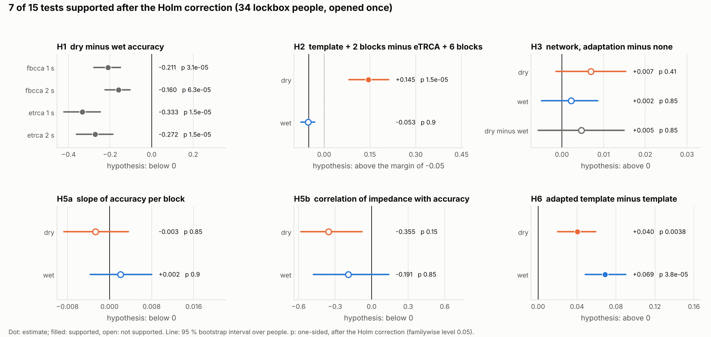
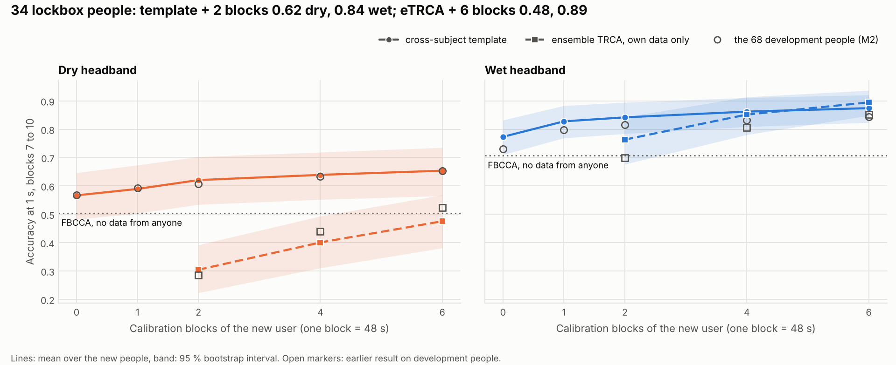

# Final evaluation: the lockbox, opened once

*13 Nov 2026. Plan: [`final_evaluation_plan.md`](final_evaluation_plan.md), approved before anything was run.
Rehearsal and lock: [`final_rehearsal.md`](final_rehearsal.md). The lockbox (34 people set aside in M0, never
decoded before) was opened **once**, on the author's word, from commit `6006614`, in a single run of 85
seconds that was not interrupted (`results/final/LOCKBOX_OPENED.txt`). Population: the 68 development people.
Every number below is in `logs/final_lockbox.log` (tests and tables) or `logs/final_summary.log`
(descriptive differences).*

> **Note added on 14 Nov 2026, after M5.** One saturated trial of one development person (S067, dry headband,
> block 4, target 4) dominates the dry population template for the 9.75 Hz target used in this report. On the
> development people, leaving it out raises the dry accuracy of the template from 0.578 to 0.590. The
> tests that use the dry template are H2, H5 and H6 with dry electrodes. The results below are those of the
> method as frozen; nothing below was changed. Details: [`M5_realtime.md`](M5_realtime.md), section F.
>
> **Corrected result, added on 14 Nov 2026** (plan approved by the author; computed after the opening, so it is
> not a second test). The same analysis was run once more with that one trial left out of the template.
> Everything that does not use the dry template is identical. **No decision changes: the same seven tests are
> supported.** Original and corrected, for the four tests that use the dry template:
>
> | Test | Original (pre-specified, below) | Corrected (after the opening) |
> |---|---|---|
> | H2 dry | +0.145 [+0.081, +0.211], p after Holm 1.5e-05, supported | +0.151 [+0.088, +0.216], 1.4e-05, supported |
> | H5a dry | -0.0027 [-0.0087, +0.0036], 0.85, not supported | -0.0039 [-0.0098, +0.0022], 0.85, not supported |
> | H5b dry | -0.355 [-0.580, -0.079], 0.15, not supported | -0.350 [-0.577, -0.074], 0.17, not supported |
> | H6 dry | +0.040 [+0.020, +0.059], 0.0038, supported | +0.045 [+0.025, +0.063], 0.00087, supported |
>
> Dry accuracy of the template with no calibration: 0.567 originally, 0.577 corrected. Full account:
> [`final_correction.md`](final_correction.md).

## Result in short

**Seven of the 15 tests are supported after the Holm correction, exactly the ones expected before the
opening.**

1. **Dry electrodes cost accuracy (H1, supported, 4 of 4 tests).** Dry minus wet: -0.21 (FBCCA, 1 s),
   -0.16 (FBCCA, 2 s), -0.33 (ensemble TRCA, 1 s), -0.27 (ensemble TRCA, 2 s). A longer window narrows the
   gap and does not close it.
2. **With dry electrodes, other people's data and 2 calibration blocks (96 s) are enough (H2 dry,
   supported):** +0.145 [+0.081, +0.211] against ensemble TRCA with 6 blocks (288 s).
3. **With wet electrodes they are not (H2 wet, not supported):** -0.053 [-0.076, -0.031]. With good signals and
   6 blocks of the user's own data, ensemble TRCA is better than the template with 2 blocks, by slightly more
   than the margin of 0.05.
4. **Updating the template with its own decisions, without labels, helps (H6, supported, 2 of 2):**
   +0.040 [+0.020, +0.059] dry and +0.069 [+0.048, +0.090] wet. H6 was written after this effect was seen on
   the development people; the lockbox confirms it.
5. **Entropy adaptation of the small network does not help (H3, not supported, 0 of 3):** +0.007 dry, +0.002
   wet.
6. **Accuracy does not fall over the ten blocks, and impedance does not predict it (H5, not supported, 0 of
   4).** The dry correlation of impedance with accuracy is -0.35 here and was +0.07 on the development people;
   after the correction it is not supported, and the two sets disagree.
7. **The development numbers were not optimistic.** With no calibration at 1 s the template reaches 0.567 dry
   and 0.773 wet on the lockbox people (development: 0.568 and 0.730). Its advantage over FBCCA is smaller with
   dry electrodes than on the development people: +0.062 [+0.034, +0.089] against +0.104 [+0.077, +0.128].

## A. The 15 tests

One-sided, familywise level 0.05 by Holm: the sorted p-values are compared with 0.05/15, 0.05/14, ... and the
procedure stops at the first failure. 34 people in every test (18 wore the dry headband first, 16 the wet one).

| # | Hypothesis | Case | Estimate [95 % interval] | p | p (Holm) | Supported |
|---|---|---|---|---|---|---|
| 1 | H1 dry below wet | FBCCA, 1 s | -0.211 [-0.278, -0.150] | 2.6e-06 | 3.1e-05 | **yes** |
| 2 | | FBCCA, 2 s | -0.160 [-0.224, -0.104] | 6.3e-06 | 6.3e-05 | **yes** |
| 3 | | ensemble TRCA, 1 s | -0.333 [-0.422, -0.246] | 1.0e-06 | 1.5e-05 | **yes** |
| 4 | | ensemble TRCA, 2 s | -0.272 [-0.362, -0.187] | 1.0e-06 | 1.5e-05 | **yes** |
| 5 | H2 template + 2 blocks within 0.05 of eTRCA + 6 blocks | dry | +0.145 [+0.081, +0.211] | 1.1e-06 | 1.5e-05 | **yes** |
| 6 | | wet | -0.053 [-0.076, -0.031] | 0.45 | 0.90 | no |
| 7 | H3 entropy adaptation helps the network | dry | +0.007 [-0.001, +0.015] | 0.059 | 0.41 | no |
| 8 | | wet | +0.002 [-0.005, +0.009] | 0.27 | 0.85 | no |
| 9 | | dry minus wet | +0.005 [-0.006, +0.015] | 0.16 | 0.85 | no |
| 10 | H5a accuracy falls over the blocks (slope per block) | dry | -0.0027 [-0.0087, +0.0036] | 0.19 | 0.85 | no |
| 11 | | wet | +0.0021 [-0.0037, +0.0080] | 0.69 | 0.90 | no |
| 12 | H5b higher impedance, lower accuracy (Spearman) | dry | -0.35 [-0.58, -0.08] | 0.019 | 0.15 | no |
| 13 | | wet | -0.19 [-0.48, +0.14] | 0.14 | 0.85 | no |
| 14 | H6 adapted template better | dry | +0.040 [+0.020, +0.059] | 0.00043 | 0.0038 | **yes** |
| 15 | | wet | +0.069 [+0.048, +0.090] | 3.5e-06 | 3.8e-05 | **yes** |

H1 uses the crossover test (the order of wearing is taken into account); H2, H3, H5a and H6 the Wilcoxon
signed-rank test; H5b a permutation test. Intervals are bootstrap intervals over people.

**Expectation written in the plan before the opening, and the outcome:**

| | Expected | Outcome |
|---|---|---|
| H1 | supported | supported (4 of 4) |
| H2 dry | supported | supported |
| H2 wet | uncertain | not supported |
| H3 | not supported | not supported (0 of 3) |
| H5 | not supported | not supported (0 of 4) |
| H6 | supported | supported (2 of 2) |

## B. Accuracy of the lockbox people, next to the development people

Blocks 7 to 10, window 1 s, mean over people [95 % interval]. "Dev." is the mean of the 68 development
people in M2 to M4. The two sets are different people, so the columns are not paired.

**No calibration:**

| Method | Dry | Dev. | Wet | Dev. |
|---|---|---|---|---|
| FBCCA (no data from anyone) | 0.504 [0.420, 0.587] | 0.465 | 0.707 [0.634, 0.775] | 0.652 |
| Cross-subject template | 0.567 [0.482, 0.646] | 0.568 | 0.773 [0.710, 0.832] | 0.730 |
| Template adapted without labels | 0.607 [0.518, 0.689] | 0.603 | 0.842 [0.782, 0.898] | 0.805 |
| Network, no adaptation (A0) | 0.508 [0.422, 0.589] | 0.534 | 0.682 [0.601, 0.760] | 0.621 |
| Network, statistics (A1) | 0.516 [0.431, 0.596] | 0.543 | 0.685 [0.604, 0.764] | 0.627 |
| Network, entropy (A2) | 0.515 [0.430, 0.596] | 0.542 | 0.684 [0.601, 0.764] | 0.626 |

**With calibration** (one block = 12 trials = 48 s):

| Method | Blocks | Dry | Dev. | Wet | Dev. |
|---|---|---|---|---|---|
| Template + own blocks | 1 | 0.589 | 0.593 | 0.828 | 0.797 |
| | 2 | 0.621 | 0.607 | 0.842 | 0.815 |
| | 4 | 0.639 | 0.633 | 0.862 | 0.831 |
| | 6 | 0.654 | 0.653 | 0.874 | 0.844 |
| Own template only | 2 | 0.588 | 0.582 | 0.842 | 0.798 |
| | 6 | 0.661 | 0.649 | 0.881 | 0.839 |
| Ensemble TRCA | 2 | 0.305 | 0.286 | 0.763 | 0.699 |
| | 4 | 0.401 | 0.440 | 0.852 | 0.806 |
| | 6 | 0.475 | 0.523 | 0.895 | 0.852 |

**The person's own ten blocks** (ensemble TRCA by leave-one-block-out, 108 calibration trials):

| Method | Window | Dry | Dev. | Wet | Dev. |
|---|---|---|---|---|---|
| FBCCA | 1 s | 0.500 | 0.475 | 0.712 | 0.658 |
| | 2 s | 0.719 | 0.702 | 0.878 | 0.836 |
| Ensemble TRCA | 1 s | 0.576 | 0.606 | 0.908 | 0.889 |
| | 2 s | 0.687 | 0.741 | 0.956 | 0.940 |

**People not above chance** (below 0.133 over 120 trials at 1 s): template: nobody with either headband;
FBCCA: one person with dry electrodes (S045), nobody with wet ones.

## C. Descriptive differences (not among the 15 tests)

Computed from the result files after the opening by `scripts/final_summary.py`; they are descriptions, with
intervals and without tests.

| Difference (blocks 7 to 10, 1 s) | Dry, lockbox | Dry, development | Wet, lockbox | Wet, development |
|---|---|---|---|---|
| Template minus FBCCA | +0.062 [+0.034, +0.089] | +0.104 [+0.077, +0.128] | +0.066 [+0.028, +0.102] | +0.078 [+0.050, +0.104] |
| Adapted template minus FBCCA | +0.103 [+0.075, +0.131] | +0.138 [+0.114, +0.161] | +0.135 [+0.102, +0.169] | +0.153 [+0.127, +0.180] |
| Template minus network (A0) | +0.058 [+0.006, +0.114] | +0.034 [+0.004, +0.066] | +0.092 [+0.044, +0.139] | +0.109 [+0.075, +0.145] |
| Template + 2 blocks minus own template, 2 blocks | +0.032 [+0.012, +0.054] | +0.025 [+0.010, +0.041] | +0.000 [-0.017, +0.018] | +0.017 [+0.002, +0.031] |
| Own template minus ensemble TRCA, 6 blocks | +0.186 [+0.125, +0.249] | +0.126 [+0.084, +0.171] | -0.014 [-0.033, +0.004] | -0.013 [-0.028, +0.003] |

- **The lockbox people are somewhat easier to decode with wet electrodes** than the development people: FBCCA,
  which uses nobody's data, is 0.055 higher (dry: 0.040). So a higher wet accuracy on the lockbox says little
  about a method; the differences between methods in the same people do.
- **The template's advantage over FBCCA holds, and is smaller with dry electrodes** than on the development
  people (+0.062 against +0.104), on whom the pipeline was chosen. With wet electrodes it is +0.066 against
  +0.078.
- **The template stays above the small network** (+0.058 dry, +0.092 wet).
- **The headband worn second is 0.032 lower** (template, ten blocks; development: 0.030).
- The adapted template is better for 24 of 34 people with dry electrodes (worse for 6) and for 30 of 34 with
  wet ones (worse for 1). The template with 2 blocks is at least as good as ensemble TRCA with 6 blocks for 28
  of 34 people with dry electrodes and for 10 of 34 with wet ones.

## D. What can be said, and what cannot

**Can be said** (tested once, on people no choice was made on):

- Dry electrodes lower the accuracy of the standard decoders by 0.16 to 0.33, depending on method and window.
- For a new user with dry electrodes, a template built from other people and combined with 96 s of
  calibration is not worse than ensemble TRCA with 288 s; it is 0.145 better.
- A template updated with its own decisions on 72 unlabelled trials gains 0.04 (dry) to 0.07 (wet).

**Cannot be said:**

- That 2 calibration blocks are enough with wet electrodes: the template with 2 blocks is 0.053 below ensemble
  TRCA with 6 blocks, and the interval lies around the margin.
- That entropy adaptation helps the network. The estimate with dry electrodes is +0.007 and the test is not
  supported. This holds for this network and this training (4 of the 6 networks stopped at the limit of 60
  epochs).
- That accuracy falls with time on task or with impedance, in recordings of ten blocks (8 minutes of trials) per headband.

**Limits.** One dataset from one laboratory, healthy people, cue-guided offline trials, 12 targets, 34 people
in the tests. H6 was formulated after its effect had been seen on the development people. The comparison with
"published" accuracies of M1 used another way of filtering and is not part of these tests.

## E. Deviations and things added after the plan

| | Point | Effect |
|---|---|---|
| D1 | The tag `pre-lockbox` exists in the repository used for the analysis. Pushing tags from that machine was refused, so on GitHub the locked commit is identified by its hash, `6006614`, pushed before the opening and recorded in `results/final/LOCKBOX_OPENED.txt`; the tag is pushed from the author's machine. | None on the results. |
| D2 | `scripts/final_summary.py` (section C and the table of expectations) was written **after** the opening. It reads result files only and runs no test. | Section C is descriptive. |
| D3 | The four points settled while the code was written, before any run, are listed in `final_rehearsal.md` (C1 to C4). | None on the tests. |
| D4 | **Corrected on 14 Nov 2026:** two interval bounds in this report had been rounded twice (from the four decimals of the log to three). The lower bound of H2 dry is +0.081 (it read +0.082) and the upper bound of H6 dry is +0.059 (it read +0.060). | None: the result files and the log were right, and no decision depends on an interval. Also corrected in the report, the README, the analysis plan and the slides. |
| D5 | **Found on 14 Nov 2026:** the Wilcoxon p-values of H2, H3 and H6 depend a little on ties. The tested differences are counts of correct trials divided by 48; two differences that are equal as fractions are not always equal as floating point numbers, so the code does not see every tie. Recomputed from the integer counts (`scripts/final_ties_check.py`, `logs/final_ties_check.log`): for example H6 dry 0.00034 instead of 0.00043, H3 wet 0.23 instead of 0.27. | **No decision changes:** the same seven tests are supported, here and in the corrected analysis. No p-value is near its threshold. The p-values of this report stay those of the pre-specified code, which the reproduction gives identically. |

Nothing else differs from the plan: no method, setting, test or exclusion was changed, and no person was
excluded.

## F. Reproducibility

- The opening wrote `results/final/lockbox/` in one run. A second opening is refused by the script.
- `python scripts/final_evaluation.py evaluate --set lockbox --open-lockbox --reproduce` recomputes everything
  into a separate folder: the four result files are identical to those of the opening, byte for byte
  (`logs/final_lockbox_reproduction.log`).
- The population template and the six networks used are those whose checksums were committed before the
  opening (`results/final/lockbox/frozen.json`).

## Files

`results/final/lockbox/` (`accuracy.csv`, `decisions_1s.csv`, `impedance.csv`, `tests.csv`, networks,
`frozen.json`), `results/final/LOCKBOX_OPENED.txt`, `figures/final/01_tests.png`, `02_calibration.png`,
`logs/final_lockbox.log`, `logs/final_lockbox_reproduction.log`, `logs/final_summary.log`,
`scripts/final_evaluation.py`, `scripts/final_figures.py`, `scripts/final_summary.py`.
