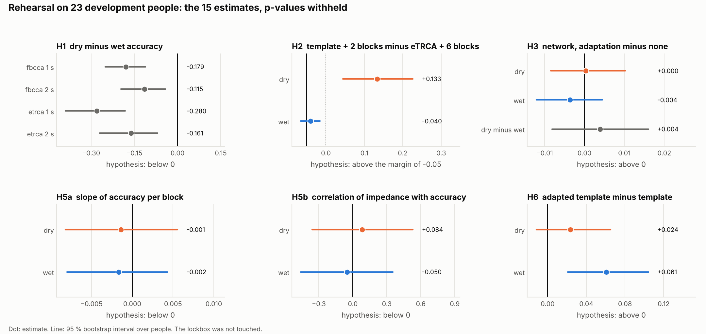
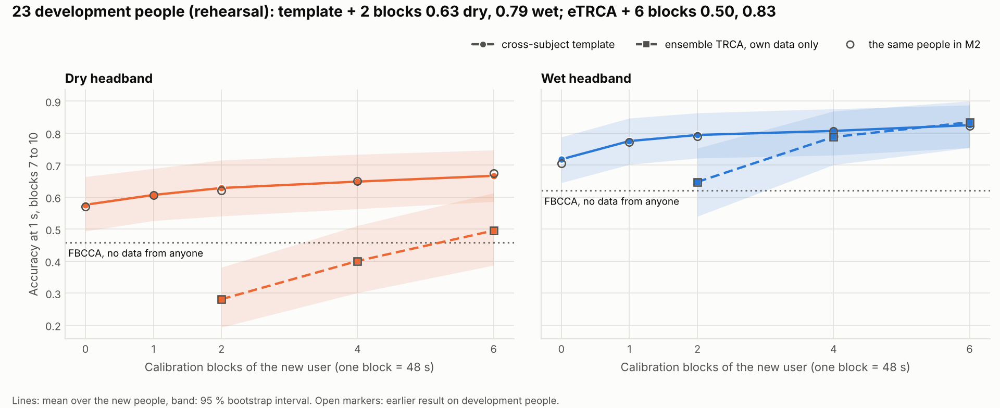

# Rehearsal of the final evaluation, and the lock

*13 Nov 2026. Plan: [`final_evaluation_plan.md`](final_evaluation_plan.md), approved by the author before
anything was run. **Development people only: the lockbox has not been opened.** 23 development people (every
third one, starting with the first) played the new people, the other 45 the population (38 for training and
7 for validation of the networks). The 15 tests were executed to exercise the code; **their p-values were
neither written nor looked at.** Every number below is in `logs/final_rehearsal.log`.*

## Result in short

1. **The script reproduces M2 exactly wherever no population is involved.** 552 accuracies (FBCCA and
   ensemble TRCA on the person's own ten blocks at 1 s and 2 s; FBCCA, the person's own template and ensemble
   TRCA on blocks 7 to 10) are identical to the result files of M2 for the same 23 people: largest
   difference 0.000000.
2. **Where a population is involved, the numbers move little.** With 45 people instead of 67 (M2, M4) or 51
   (M3) in the population, the mean accuracy of the template changes by -0.008 to +0.013, and that of the
   re-trained networks by +0.002 to +0.020.
3. **All 15 tests ran and returned finite p-values.** The estimates of the 23 people are close to what M2,
   M3 and M4 reported for the 68 (those of H3 and H5 are near zero, as there).
4. **The guard works** (unit tests): a lockbox person cannot be loaded without `--open-lockbox`; the opening
   needs a clean commit tagged `pre-lockbox`; it is refused once the lockbox has been opened.
5. **Everything the lockbox people will be decoded with exists already** and comes from the 68 development
   people only: the population template and the six networks. Their checksums are in
   `results/final/lockbox/frozen.json`, inside the tagged commit, and the opening refuses to run if they differ.

**Next: the opening,** one command from the commit tagged `pre-lockbox`, when the author says so.

## A. The 15 estimates on the 23 rehearsal people (no p-value)



| Test | Case | Quantity | Estimate [95 % interval] |
|---|---|---|---|
| H1 | FBCCA 1 s | dry minus wet accuracy (crossover estimate) | -0.179 [-0.251, -0.111] |
| H1 | FBCCA 2 s | | -0.115 [-0.196, -0.042] |
| H1 | eTRCA 1 s | | -0.280 [-0.389, -0.181] |
| H1 | eTRCA 2 s | | -0.161 [-0.270, -0.070] |
| H2 | dry | template + 2 blocks minus eTRCA + 6 blocks (margin -0.05) | +0.133 [+0.044, +0.227] |
| H2 | wet | | -0.040 [-0.065, -0.015] |
| H3 | dry | network: A2 minus A0 | +0.000 [-0.009, +0.010] |
| H3 | wet | | -0.004 [-0.012, +0.005] |
| H3 | dry minus wet | | +0.004 [-0.008, +0.016] |
| H5a | dry | slope of accuracy per block | -0.0014 [-0.0082, +0.0056] |
| H5a | wet | | -0.0017 [-0.0080, +0.0043] |
| H5b | dry | Spearman of log10 impedance with accuracy | +0.08 [-0.36, +0.53] |
| H5b | wet | | -0.05 [-0.46, +0.35] |
| H6 | dry | adapted template minus template | +0.024 [-0.012, +0.065] |
| H6 | wet | | +0.061 [+0.021, +0.104] |

These are 23 development people: the table shows that the code computes what the plan says, nothing more.

## B. Accuracy of the 23 rehearsal people, next to M2 to M4 for the same people



No calibration, blocks 7 to 10, 1 s:

| Method | Dry | Dry before | Wet | Wet before |
|---|---|---|---|---|
| FBCCA | 0.458 | 0.458 | 0.620 | 0.620 |
| Cross-subject template | 0.576 | 0.570 | 0.718 | 0.705 |
| Template adapted without labels | 0.600 | 0.606 | 0.779 | 0.779 |
| Network, no adaptation (A0) | 0.543 | 0.532 | 0.638 | 0.618 |
| Network, A1 | 0.546 | 0.539 | 0.636 | 0.628 |
| Network, A2 | 0.543 | 0.541 | 0.634 | 0.627 |

"Before" is the same 23 people in M2 (FBCCA, template; population 67), and M3 (adapted template, networks;
population 51). With calibration (1 s, blocks 7 to 10): template + 2 blocks 0.629 dry and 0.794 wet (before:
0.620, 0.791); ensemble TRCA + 6 blocks 0.495 and 0.834 (identical).

## C. What was added to the plan while writing the code

Nothing in the plan was changed. Four points that the plan left open were settled before any run:

| | Point | Reason |
|---|---|---|
| C1 | The population template and the six networks for the lockbox people were built **before** the opening, from the 68 development people, and their checksums are in the tagged commit. | Nothing is left to compute or choose at the opening except the decoding of the 34 people. |
| C2 | The opening is recorded in `results/final/LOCKBOX_OPENED.txt` before the first lockbox person is decoded. If the run is interrupted before it finishes, it can be resumed from the same commit only (`--resume-interrupted`). After the opening, `--reproduce` recomputes the same numbers into a separate folder and compares them. | The machine used here can restart; the repository must stay reproducible after the opening. |
| C3 | Intervals: for H1 people are resampled within each order of wearing; for H5b the correlation is bootstrapped. Wilcoxon tests use the default method of SciPy (version in `requirements.txt`). | Not specified in the plan. |
| C4 | The two figures of the final report are drawn by `scripts/final_figures.py`, written now; their titles are generated from the numbers. | No figure is designed after the lockbox results are known. |

## D. How the opening will be run

```bash
git checkout pre-lockbox
python scripts/final_evaluation.py evaluate --set lockbox --raw "$WEARABLE_DIR" --open-lockbox | tee logs/final_lockbox.log
python scripts/final_figures.py --set lockbox
```

It takes about one minute. After it, no method, setting, test or exclusion is changed.

## Files

`scripts/final_evaluation.py`, `scripts/final_figures.py`, `src/ssvep/lockbox.py`, `src/ssvep/stats.py`,
`tests/test_final.py`, `results/final/rehearsal/`, `results/final/lockbox/` (networks, training log and
checksums only), `figures/final/rehearsal/`, `logs/final_rehearsal*.log`, `logs/final_lockbox_prepare.log`.
